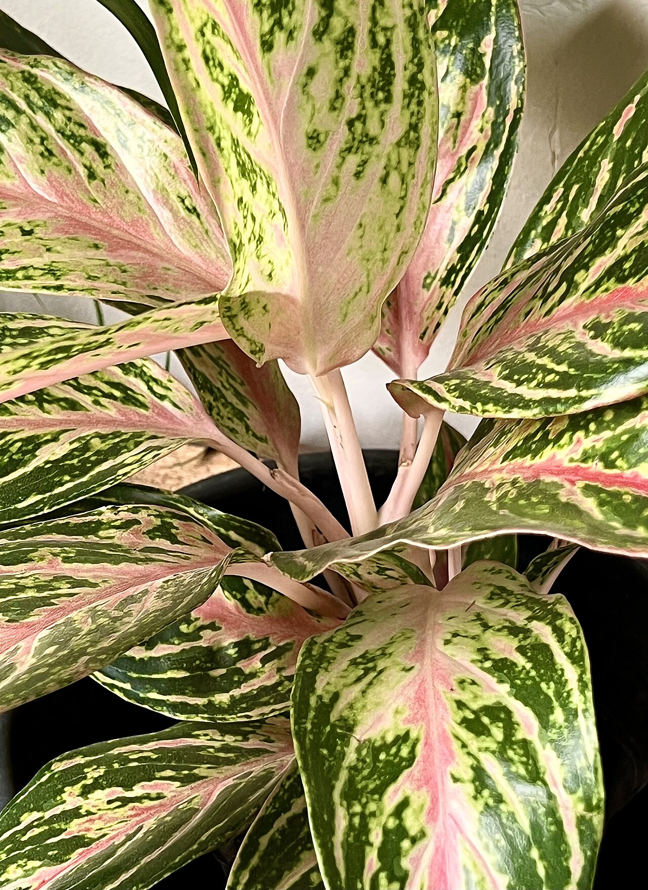
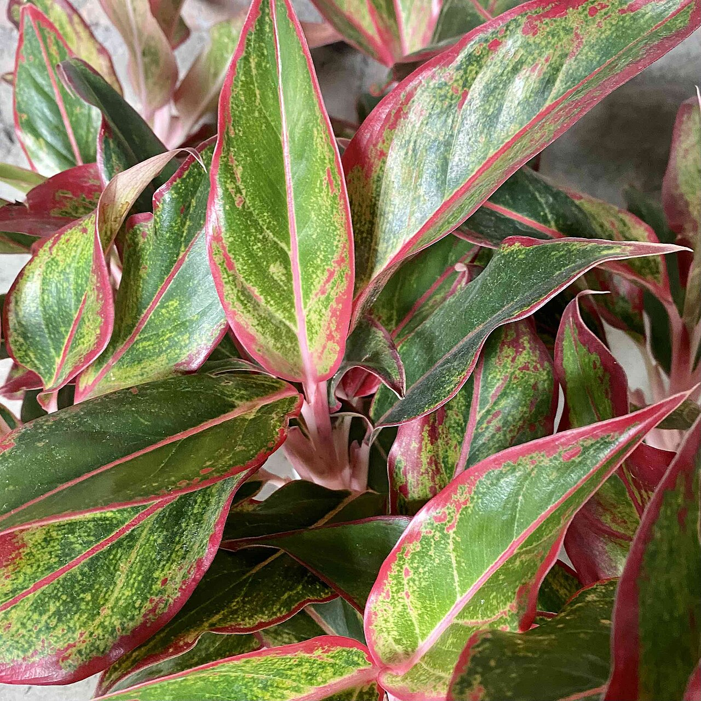
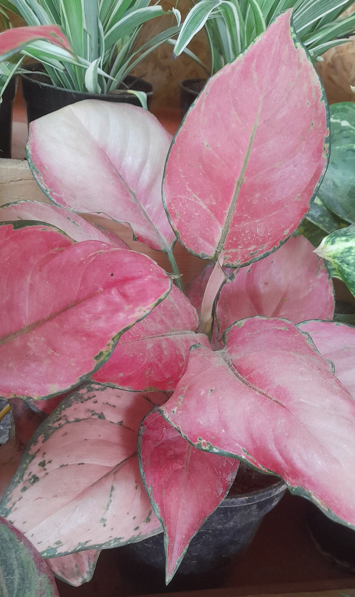
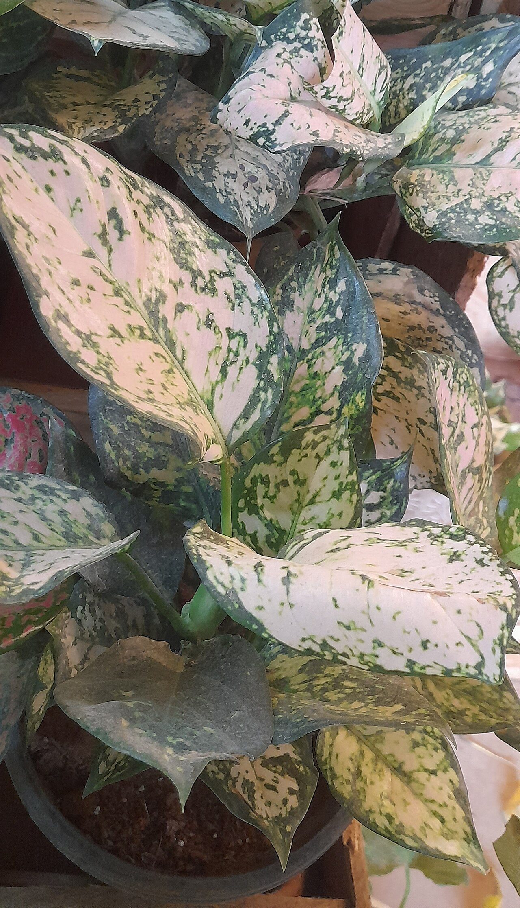
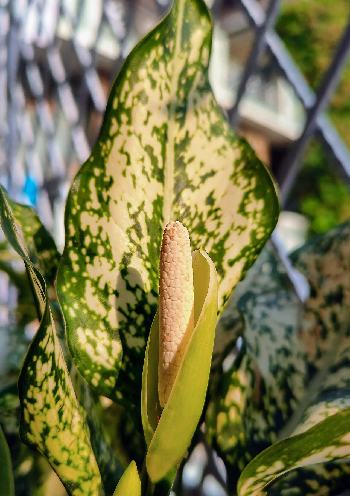
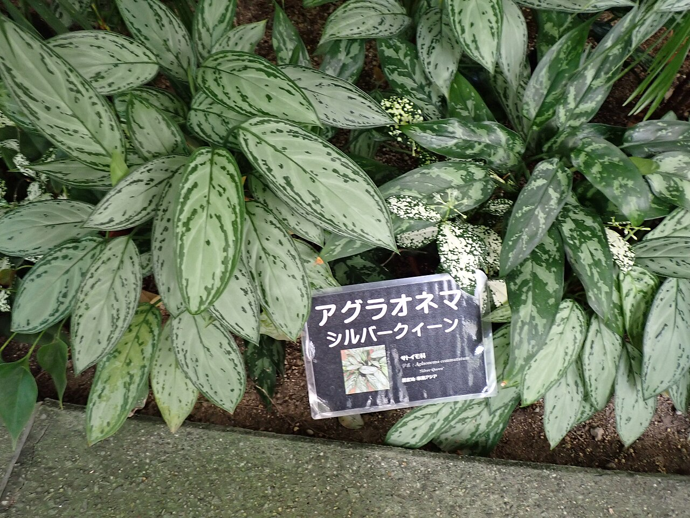
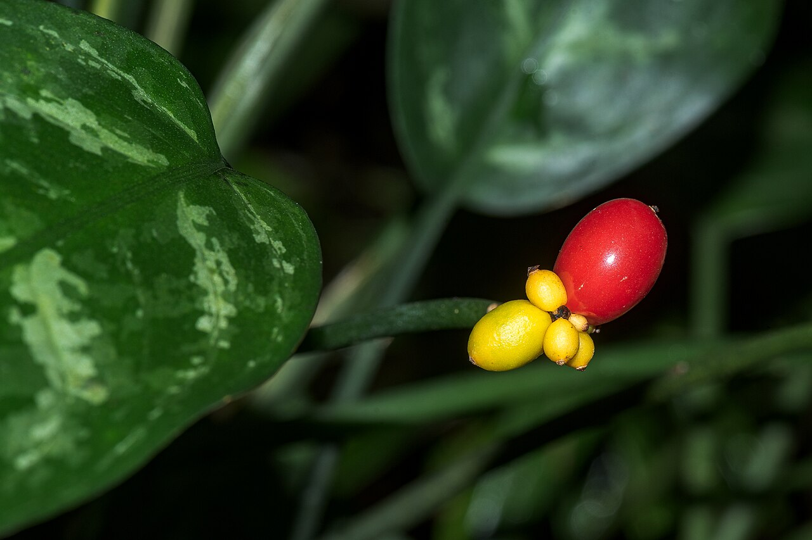
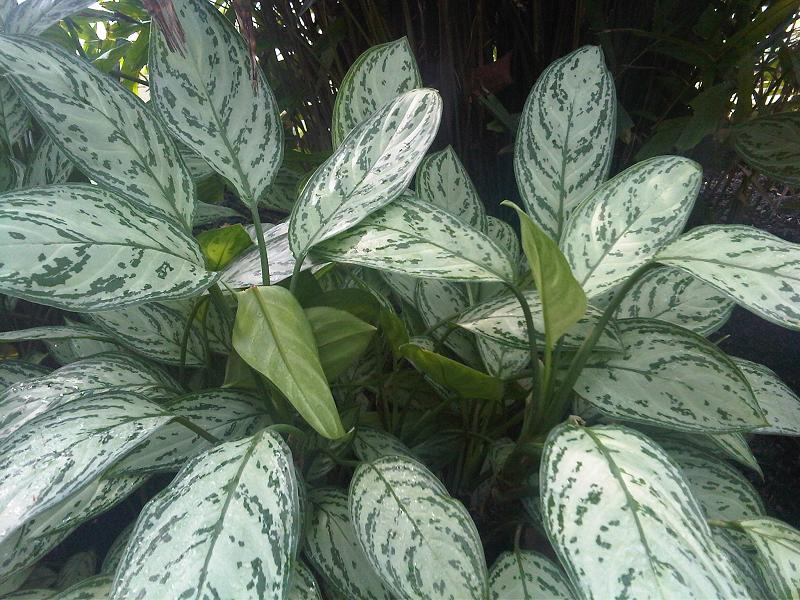
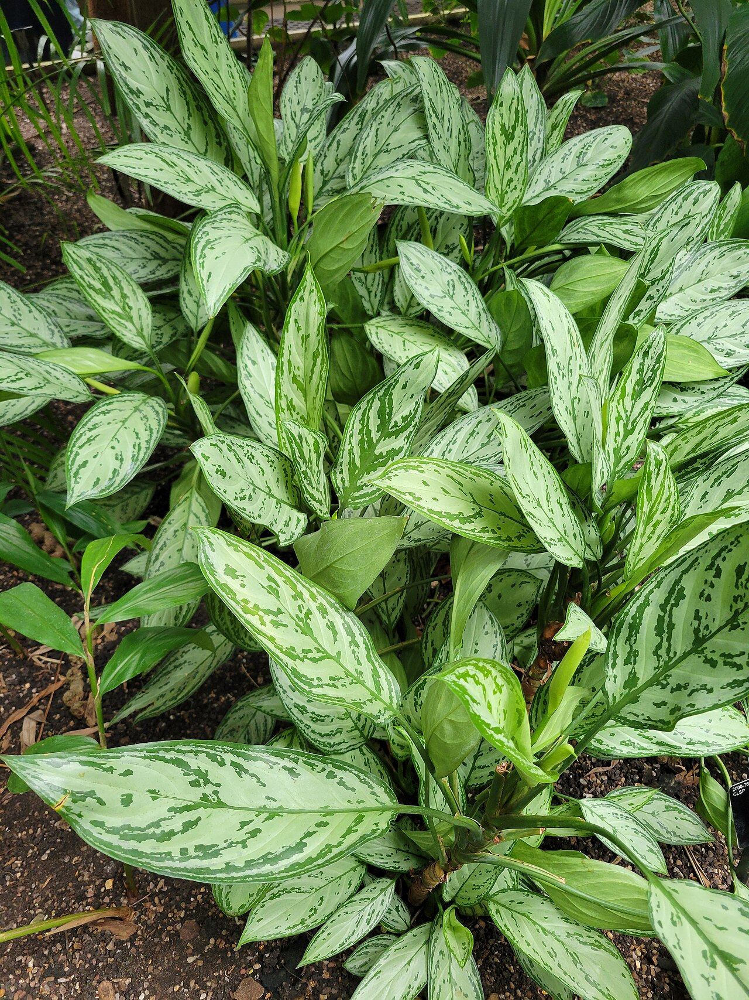
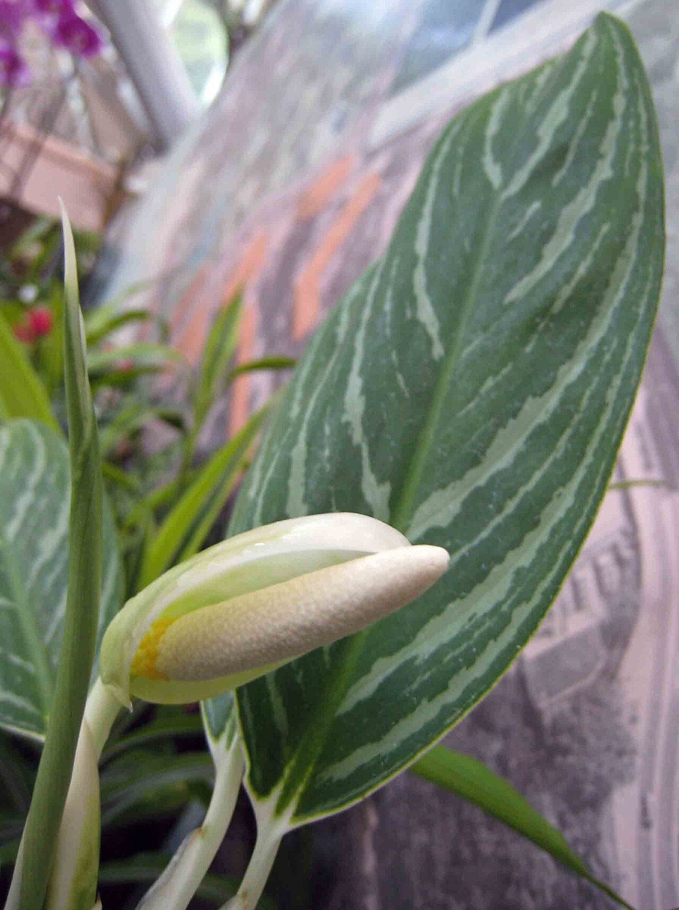

# Alpine Spires Chinese evergreen photo archive

_Aglaonema commutatum_ - Houseplant-08

Collection label ID: `#15`.

Species-reference photographs may show other leaf colors or named selections of Aglaonema commutatum; none is assumed to show Igneous Alpine Spires. They are not photographs of P41 and do not establish the owned plant's cultivar identity.

Collection research: [open the plant profile](../../../docs/plants/houseplants/aglaonema-commutatum-alpine-spires.md).

## Gallery

_habit_ - [Aglaonema commutatum.jpg](https://commons.wikimedia.org/wiki/File:Aglaonema_commutatum.jpg); Afimaame; [CC BY-SA 4.0](https://creativecommons.org/licenses/by-sa/4.0).

_habit_ - [Aglaonema commutatum (lipstick).jpg](<https://commons.wikimedia.org/wiki/File:Aglaonema_commutatum_(lipstick).jpg>); Aritra Bhawani; [CC BY-SA 4.0](https://creativecommons.org/licenses/by-sa/4.0).

_detail_ - [Aglaonema commutatum cv pink-3-jayanti nagar-begaloru-India.jpg](https://commons.wikimedia.org/wiki/File:Aglaonema_commutatum_cv_pink-3-jayanti_nagar-begaloru-India.jpg); Yercaud-elango; [CC BY-SA 4.0](https://creativecommons.org/licenses/by-sa/4.0).

_detail_ - [Aglaonema commutatum cv pink beauty -jayanti nagar-bengalore-India.jpg](https://commons.wikimedia.org/wiki/File:Aglaonema_commutatum_cv_pink_beauty_-jayanti_nagar-bengalore-India.jpg); Yercaud-elango; [CC BY-SA 4.0](https://creativecommons.org/licenses/by-sa/4.0).

_flower_ - [Aglaonema commutatum (poison dart plant).jpg](<https://commons.wikimedia.org/wiki/File:Aglaonema_commutatum_(poison_dart_plant).jpg>); Redmyname31; [CC BY-SA 4.0](https://creativecommons.org/licenses/by-sa/4.0).

_habit_ - [Aglaonema commutatum 'Silver Queen' in Hyogo Prefectural Flower Center.jpg](https://commons.wikimedia.org/wiki/File:Aglaonema_commutatum_%27Silver_Queen%27_in_Hyogo_Prefectural_Flower_Center.jpg); M108t; [CC BY 4.0](https://creativecommons.org/licenses/by/4.0).

_fruit-seed_ - [20260317 Aglaonema commutatum.jpg](https://commons.wikimedia.org/wiki/File:20260317_Aglaonema_commutatum.jpg); Flocci Nivis; [CC BY 4.0](https://creativecommons.org/licenses/by/4.0).

_habit_ - [Alismatales - Aglaonema commutatum - kew 1.jpg](https://commons.wikimedia.org/wiki/File:Alismatales_-_Aglaonema_commutatum_-_kew_1.jpg); Emőke Dénes; [CC BY-SA 4.0](https://creativecommons.org/licenses/by-sa/4.0).

_habit_ - [Aglaonema commutatum 'Silver Queen', Kew Gardens 2026 01.jpg](https://commons.wikimedia.org/wiki/File:Aglaonema_commutatum_%27Silver_Queen%27,_Kew_Gardens_2026_01.jpg); Shuvaev; [CC BY 4.0](https://creativecommons.org/licenses/by/4.0).

_flower_ - [白馬粗肋草 Aglaonema commutatum 'White Tip' -香港公園 Hong Kong Park- (14599546520).jpg](<https://commons.wikimedia.org/wiki/File:%E7%99%BD%E9%A6%AC%E7%B2%97%E8%82%8B%E8%8D%89_Aglaonema_commutatum_%27White_Tip%27_-%E9%A6%99%E6%B8%AF%E5%85%AC%E5%9C%92_Hong_Kong_Park-_(14599546520).jpg>); 阿橋 HQ; [CC BY-SA 2.0](https://creativecommons.org/licenses/by-sa/2.0).

## File details

| File                                                                   | Subject    | Source                                                                                                                                                                                                                    | Creator        | License                                                        |
| ---------------------------------------------------------------------- | ---------- | ------------------------------------------------------------------------------------------------------------------------------------------------------------------------------------------------------------------------- | -------------- | -------------------------------------------------------------- |
| [commons-129160784-habit.jpg](./commons-129160784-habit.jpg)           | habit      | [Wikimedia Commons](https://commons.wikimedia.org/wiki/File:Aglaonema_commutatum.jpg)                                                                                                                                     | Afimaame       | [CC BY-SA 4.0](https://creativecommons.org/licenses/by-sa/4.0) |
| [commons-131603360-flower.jpg](./commons-131603360-flower.jpg)         | flower     | [Wikimedia Commons](<https://commons.wikimedia.org/wiki/File:Aglaonema_commutatum_(lipstick).jpg>)                                                                                                                        | Aritra Bhawani | [CC BY-SA 4.0](https://creativecommons.org/licenses/by-sa/4.0) |
| [commons-152020036-detail.jpg](./commons-152020036-detail.jpg)         | detail     | [Wikimedia Commons](https://commons.wikimedia.org/wiki/File:Aglaonema_commutatum_cv_pink-3-jayanti_nagar-begaloru-India.jpg)                                                                                              | Yercaud-elango | [CC BY-SA 4.0](https://creativecommons.org/licenses/by-sa/4.0) |
| [commons-152020110-detail.jpg](./commons-152020110-detail.jpg)         | detail     | [Wikimedia Commons](https://commons.wikimedia.org/wiki/File:Aglaonema_commutatum_cv_pink_beauty_-jayanti_nagar-bengalore-India.jpg)                                                                                       | Yercaud-elango | [CC BY-SA 4.0](https://creativecommons.org/licenses/by-sa/4.0) |
| [commons-161866981-flower.jpg](./commons-161866981-flower.jpg)         | flower     | [Wikimedia Commons](<https://commons.wikimedia.org/wiki/File:Aglaonema_commutatum_(poison_dart_plant).jpg>)                                                                                                               | Redmyname31    | [CC BY-SA 4.0](https://creativecommons.org/licenses/by-sa/4.0) |
| [commons-180586892-flower.jpg](./commons-180586892-flower.jpg)         | flower     | [Wikimedia Commons](https://commons.wikimedia.org/wiki/File:Aglaonema_commutatum_%27Silver_Queen%27_in_Hyogo_Prefectural_Flower_Center.jpg)                                                                               | M108t          | [CC BY 4.0](https://creativecommons.org/licenses/by/4.0)       |
| [commons-186709260-fruit-seed.jpg](./commons-186709260-fruit-seed.jpg) | fruit-seed | [Wikimedia Commons](https://commons.wikimedia.org/wiki/File:20260317_Aglaonema_commutatum.jpg)                                                                                                                            | Flocci Nivis   | [CC BY 4.0](https://creativecommons.org/licenses/by/4.0)       |
| [commons-19199839-habit.jpg](./commons-19199839-habit.jpg)             | habit      | [Wikimedia Commons](https://commons.wikimedia.org/wiki/File:Alismatales_-_Aglaonema_commutatum_-_kew_1.jpg)                                                                                                               | Emőke Dénes    | [CC BY-SA 4.0](https://creativecommons.org/licenses/by-sa/4.0) |
| [commons-195970728-habit.jpg](./commons-195970728-habit.jpg)           | habit      | [Wikimedia Commons](https://commons.wikimedia.org/wiki/File:Aglaonema_commutatum_%27Silver_Queen%27,_Kew_Gardens_2026_01.jpg)                                                                                             | Shuvaev        | [CC BY 4.0](https://creativecommons.org/licenses/by/4.0)       |
| [commons-91920836-habitat.jpg](./commons-91920836-habitat.jpg)         | habitat    | [Wikimedia Commons](<https://commons.wikimedia.org/wiki/File:%E7%99%BD%E9%A6%AC%E7%B2%97%E8%82%8B%E8%8D%89_Aglaonema_commutatum_%27White_Tip%27_-%E9%A6%99%E6%B8%AF%E5%85%AC%E5%9C%92_Hong_Kong_Park-_(14599546520).jpg>) | 阿橋 HQ        | [CC BY-SA 2.0](https://creativecommons.org/licenses/by-sa/2.0) |

Metadata and SHA-256 hashes are also available in [the global manifest](../photo-manifest.json).
