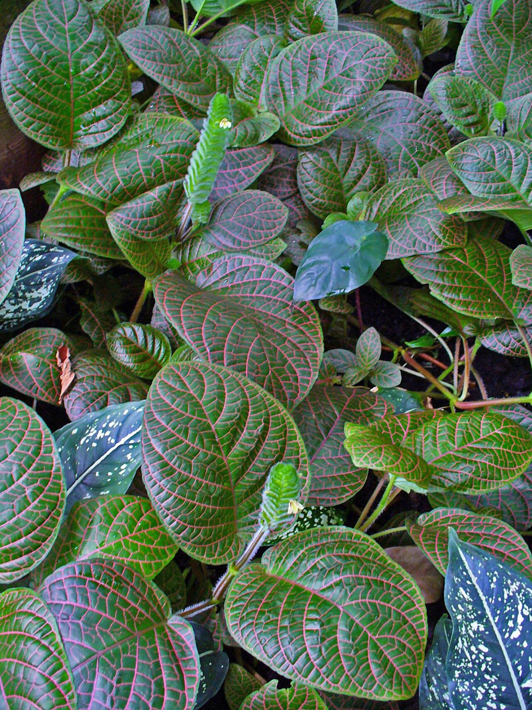
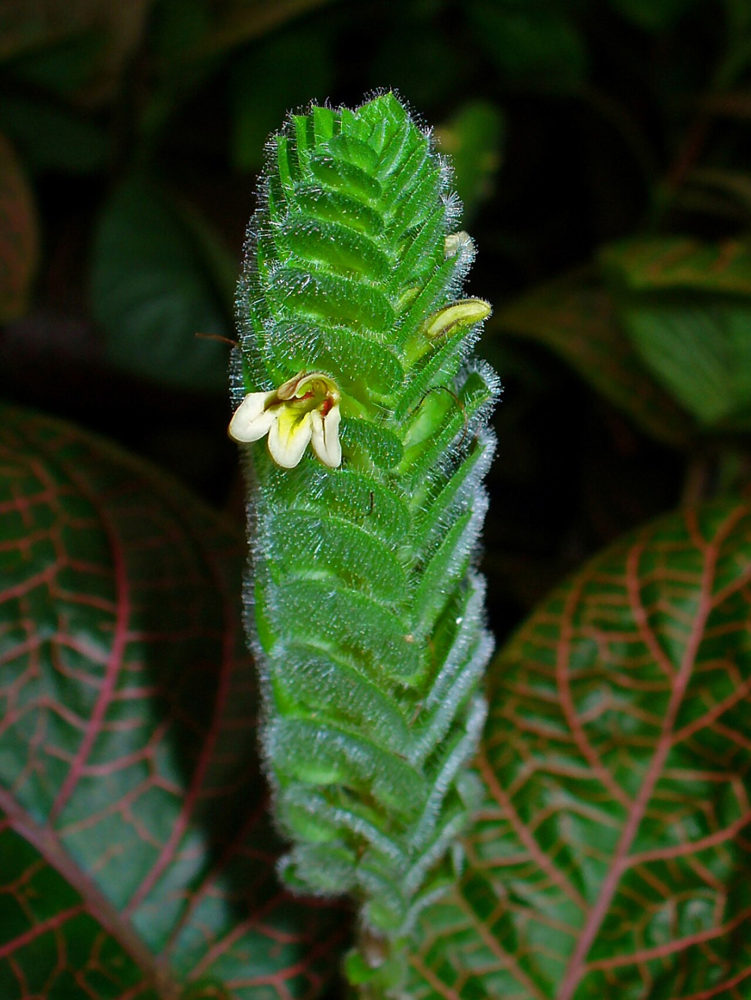
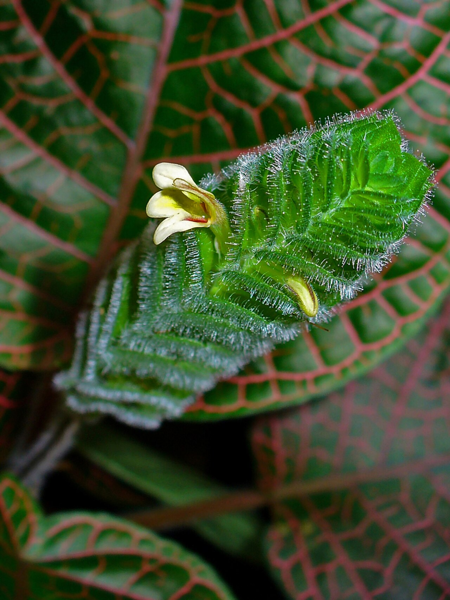
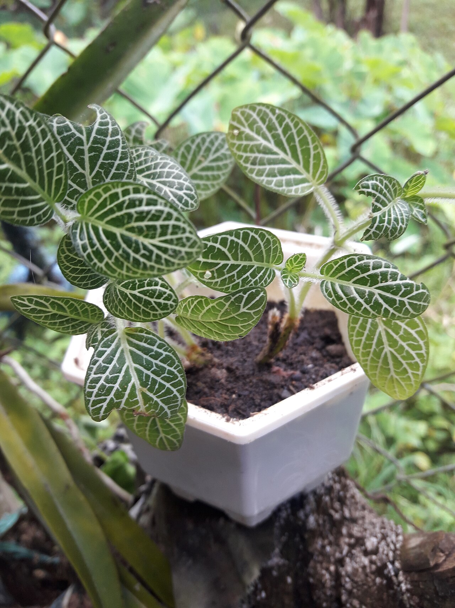
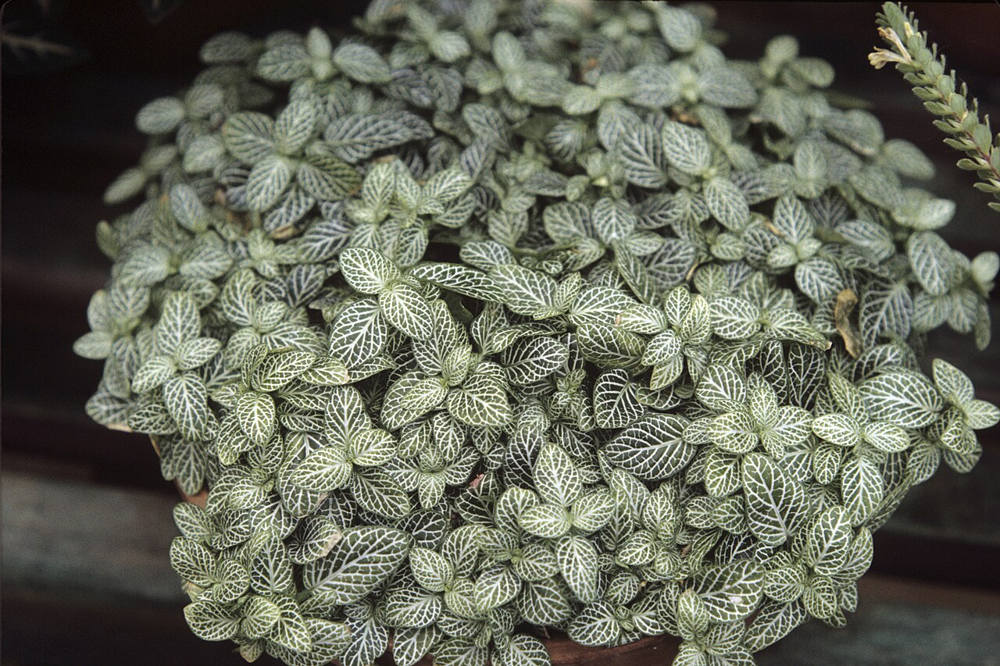
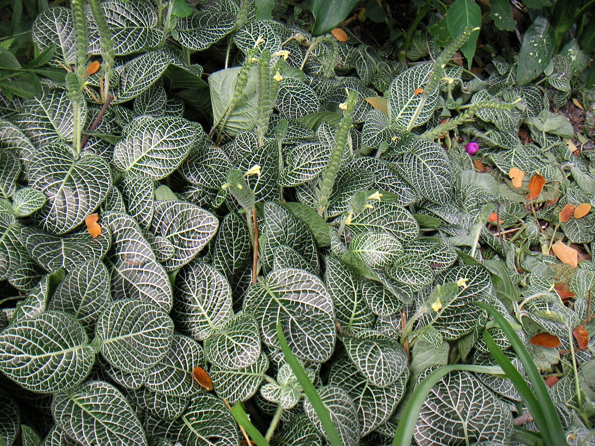
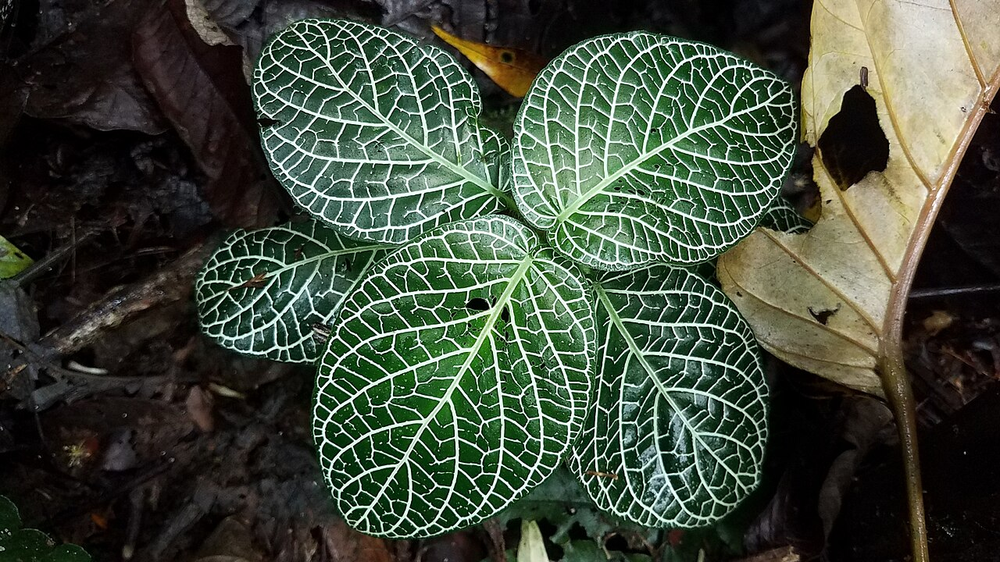
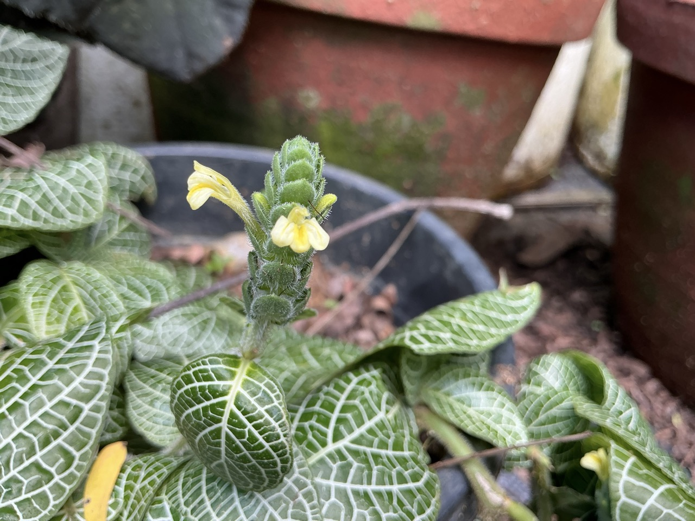
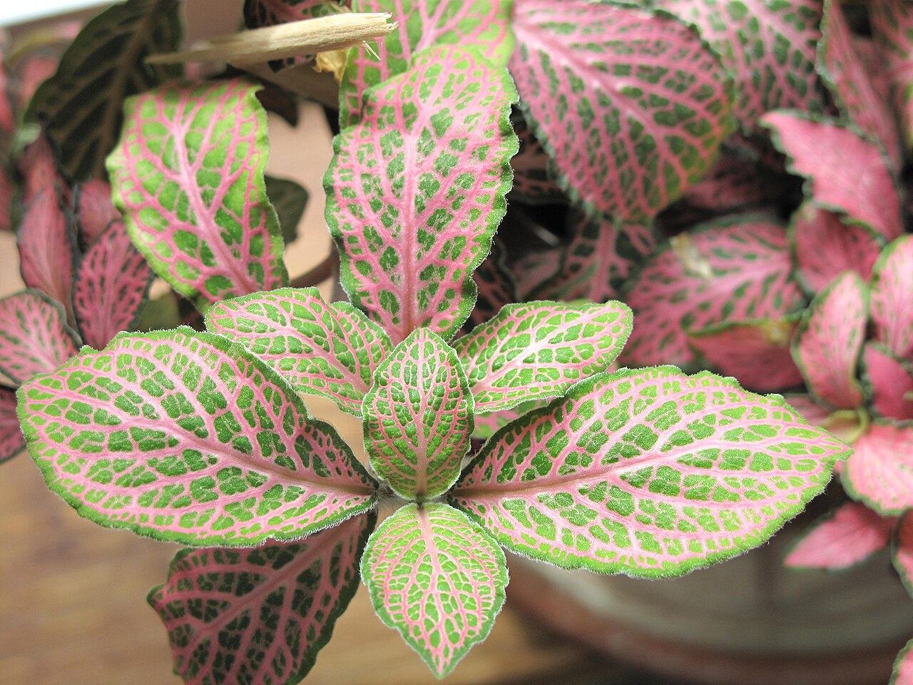
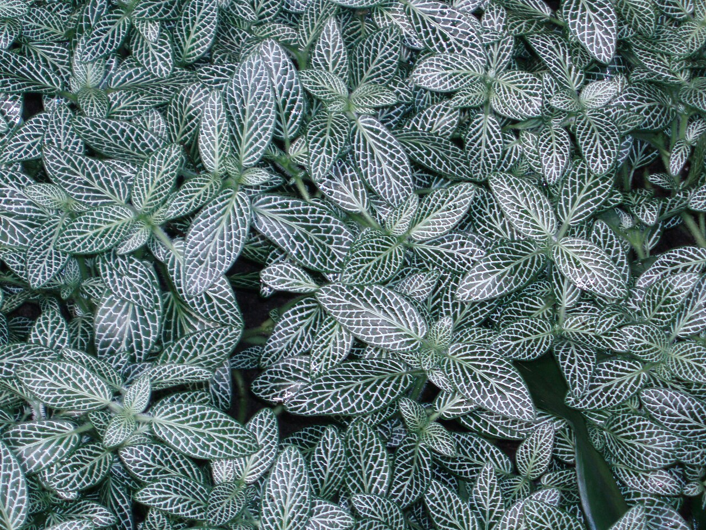

# Nightly nerve plant photo archive

_Fittonia albivenis_ - Houseplant-06

Collection label ID: `#13`.

Species-reference photographs may show other leaf colors or selections of Fittonia albivenis; none is assumed to show Network News Nightly. These references do not establish the owned plant's cultivar identity.

Collection research: [open the plant profile](../../../docs/plants/houseplants/fittonia-albivenis-nightly.md).

## Gallery

_habit_ - [Fittonia albivenis 001.JPG](https://commons.wikimedia.org/wiki/File:Fittonia_albivenis_001.JPG); H. Zell; [CC BY-SA 3.0](https://creativecommons.org/licenses/by-sa/3.0).

_flower_ - [Fittonia albivenis 002.JPG](https://commons.wikimedia.org/wiki/File:Fittonia_albivenis_002.JPG); H. Zell; [CC BY-SA 3.0](https://creativecommons.org/licenses/by-sa/3.0).

_flower_ - [Fittonia albivenis 003.JPG](https://commons.wikimedia.org/wiki/File:Fittonia_albivenis_003.JPG); H. Zell; [CC BY-SA 3.0](https://creativecommons.org/licenses/by-sa/3.0).

_habit_ - [Fittonia albivenis2022.jpg](https://commons.wikimedia.org/wiki/File:Fittonia_albivenis2022.jpg); Derk29; [CC BY-SA 4.0](https://creativecommons.org/licenses/by-sa/4.0).

_habit_ - [Fittonia albivenis WPC.jpg](https://commons.wikimedia.org/wiki/File:Fittonia_albivenis_WPC.jpg); WayneRay; [Public domain](https://creativecommons.org/publicdomain/zero/1.0/).

_habit_ - [Colpfl25.jpg](https://commons.wikimedia.org/wiki/File:Colpfl25.jpg); Louise Wolff -- darina 00:12, 7 May 2005 (UTC); [CC BY-SA 3.0](https://creativecommons.org/licenses/by-sa/3.0/).

_habit_ - [Fittonia albivenis 61868979.jpg](https://commons.wikimedia.org/wiki/File:Fittonia_albivenis_61868979.jpg); Alan Rockefeller; [CC BY 4.0](https://creativecommons.org/licenses/by/4.0).

_flower_ - [Nerve plant @ Leyam, Vadakkethara, Thenkurissi, Palakkad.jpg](https://commons.wikimedia.org/wiki/File:Nerve_plant_@_Leyam,_Vadakkethara,_Thenkurissi,_Palakkad.jpg); Mazhanilavu; [CC BY-SA 4.0](https://creativecommons.org/licenses/by-sa/4.0).

_detail_ - [Fittonia TP2.jpg](https://commons.wikimedia.org/wiki/File:Fittonia_TP2.jpg); Tangopaso; [Public domain](https://creativecommons.org/publicdomain/zero/1.0/).

_habitat_ - [Fittonia albivenis1.jpg](https://commons.wikimedia.org/wiki/File:Fittonia_albivenis1.jpg); JFKCom; [CC BY 2.5](https://creativecommons.org/licenses/by/2.5).

## File details

| File                                                         | Subject | Source                                                                                                                    | Creator                                        | License                                                             |
| ------------------------------------------------------------ | ------- | ------------------------------------------------------------------------------------------------------------------------- | ---------------------------------------------- | ------------------------------------------------------------------- |
| [commons-10116155-habit.jpg](./commons-10116155-habit.jpg)   | habit   | [Wikimedia Commons](https://commons.wikimedia.org/wiki/File:Fittonia_albivenis_001.JPG)                                   | H. Zell                                        | [CC BY-SA 3.0](https://creativecommons.org/licenses/by-sa/3.0)      |
| [commons-10116168-flower.jpg](./commons-10116168-flower.jpg) | flower  | [Wikimedia Commons](https://commons.wikimedia.org/wiki/File:Fittonia_albivenis_002.JPG)                                   | H. Zell                                        | [CC BY-SA 3.0](https://creativecommons.org/licenses/by-sa/3.0)      |
| [commons-10116186-flower.jpg](./commons-10116186-flower.jpg) | flower  | [Wikimedia Commons](https://commons.wikimedia.org/wiki/File:Fittonia_albivenis_003.JPG)                                   | H. Zell                                        | [CC BY-SA 3.0](https://creativecommons.org/licenses/by-sa/3.0)      |
| [commons-120423367-habit.jpg](./commons-120423367-habit.jpg) | habit   | [Wikimedia Commons](https://commons.wikimedia.org/wiki/File:Fittonia_albivenis2022.jpg)                                   | Derk29                                         | [CC BY-SA 4.0](https://creativecommons.org/licenses/by-sa/4.0)      |
| [commons-1295471-habit.jpg](./commons-1295471-habit.jpg)     | habit   | [Wikimedia Commons](https://commons.wikimedia.org/wiki/File:Fittonia_albivenis_WPC.jpg)                                   | WayneRay                                       | [Public domain](https://creativecommons.org/publicdomain/zero/1.0/) |
| [commons-132446-habit.jpg](./commons-132446-habit.jpg)       | habit   | [Wikimedia Commons](https://commons.wikimedia.org/wiki/File:Colpfl25.jpg)                                                 | Louise Wolff -- darina 00:12, 7 May 2005 (UTC) | [CC BY-SA 3.0](https://creativecommons.org/licenses/by-sa/3.0/)     |
| [commons-134547856-habit.jpg](./commons-134547856-habit.jpg) | habit   | [Wikimedia Commons](https://commons.wikimedia.org/wiki/File:Fittonia_albivenis_61868979.jpg)                              | Alan Rockefeller                               | [CC BY 4.0](https://creativecommons.org/licenses/by/4.0)            |
| [commons-153323170-habit.jpg](./commons-153323170-habit.jpg) | flower  | [Wikimedia Commons](https://commons.wikimedia.org/wiki/File:Nerve_plant_@_Leyam,_Vadakkethara,_Thenkurissi,_Palakkad.jpg) | Mazhanilavu                                    | [CC BY-SA 4.0](https://creativecommons.org/licenses/by-sa/4.0)      |
| [commons-20400367-detail.jpg](./commons-20400367-detail.jpg) | detail  | [Wikimedia Commons](https://commons.wikimedia.org/wiki/File:Fittonia_TP2.jpg)                                             | Tangopaso                                      | [Public domain](https://creativecommons.org/publicdomain/zero/1.0/) |
| [commons-2151135-habitat.jpg](./commons-2151135-habitat.jpg) | habitat | [Wikimedia Commons](https://commons.wikimedia.org/wiki/File:Fittonia_albivenis1.jpg)                                      | JFKCom                                         | [CC BY 2.5](https://creativecommons.org/licenses/by/2.5)            |

Metadata and SHA-256 hashes are also available in [the global manifest](../photo-manifest.json).
