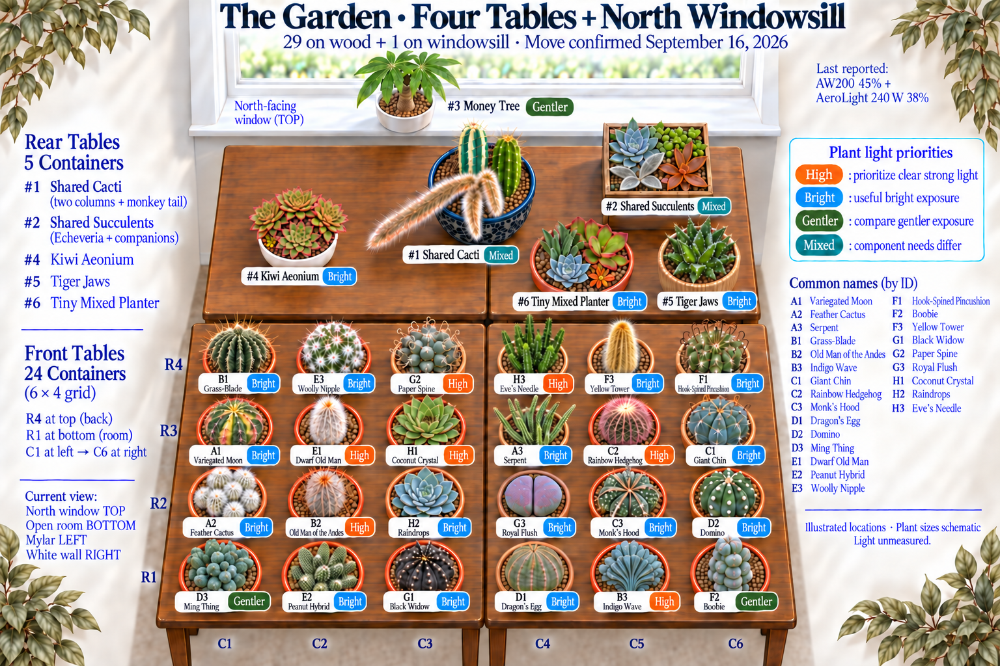
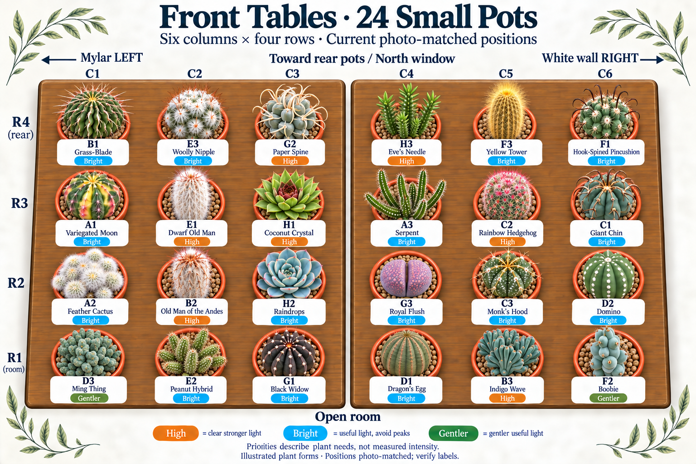
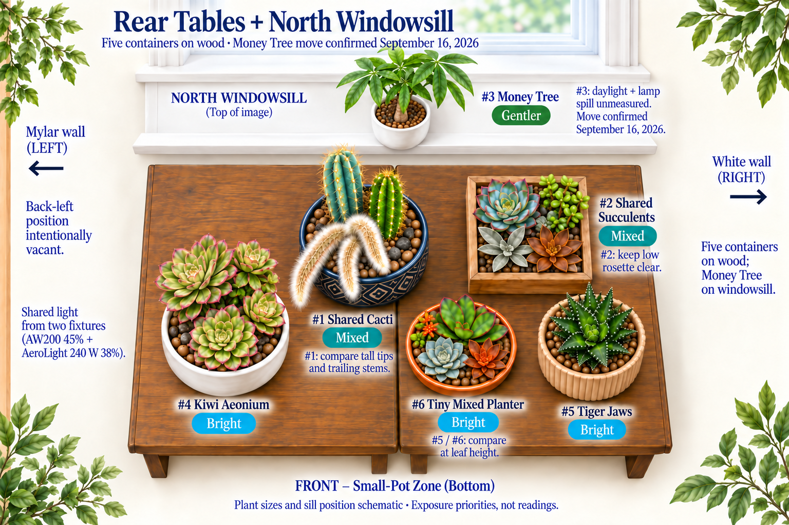
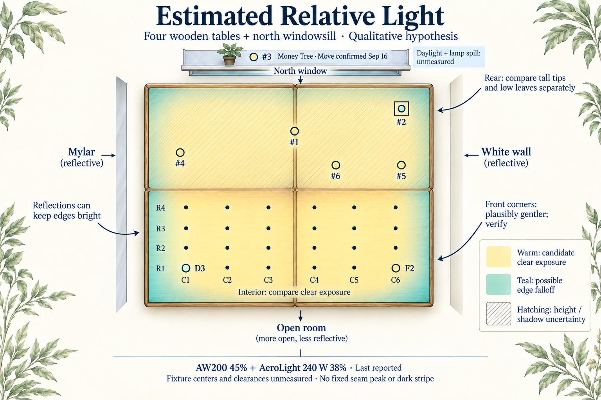
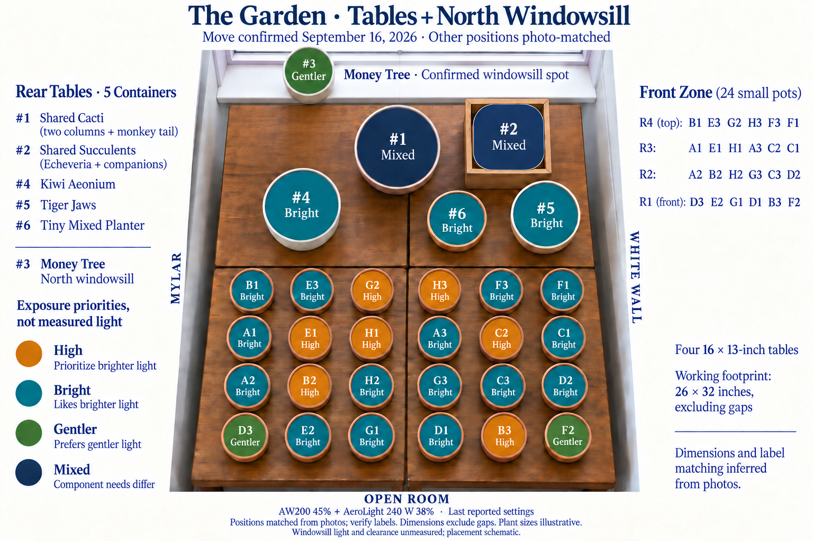
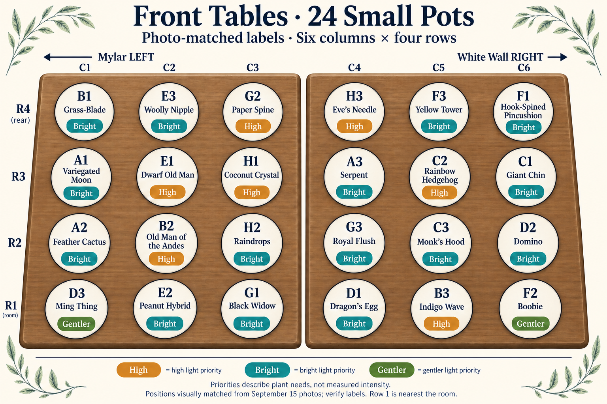
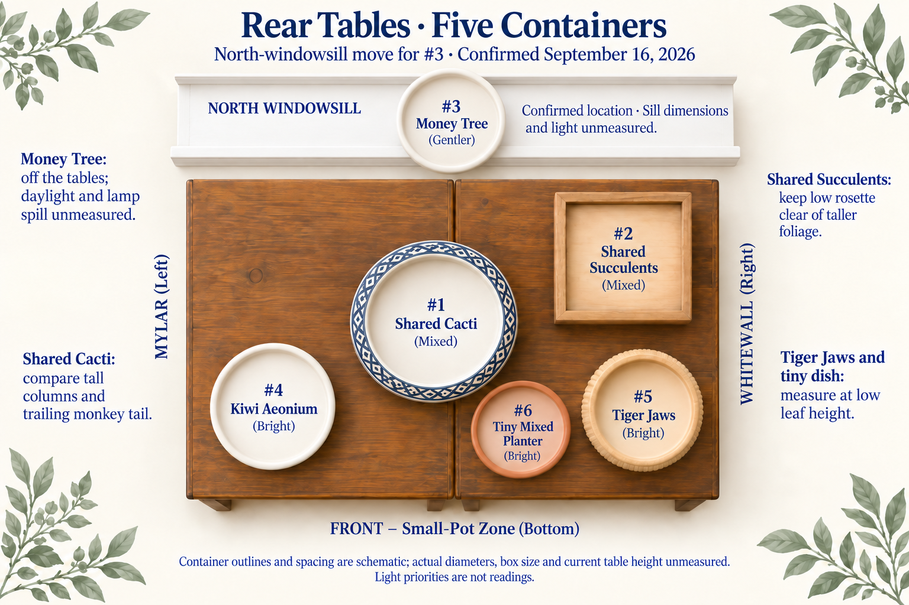

# Table Placement Guide

## Current scope

The collection has **38 tracked containers**. Owner photographs supplied **October 22, 2026** update the recorded arrangement; the capture date was not supplied. The front display still has 24 small pots in six columns and four rows. P35 / #9 Lithops is at the rear left behind Kiwi, and P36 / #10 split rock is at the rear center-right between the shared cactus and square succulent box. P21 / #3 Money Tree is on a stool on the room side of the display; P38 / #12 Terrarium is on the desk to the right. The owner confirmed October 23 that the pale rosette in the grey/blue pot at the back center-left is P37 / #11 Arctic Ice, between P35 Lithops and P19 shared cactus.

P31 / #7 Peperomia and P32 / #8 oyster plant are absent from these views. Their **last reported location was the room-side floor on September 20**; their current location and the planned living-room move remain unverified. P39 / #13 [Nightly nerve plant](../plants/houseplants/fittonia-albivenis-nightly.md) and P40 / #14 [Spice is Nice peperomia](../plants/houseplants/peperomia-obtusifolia-spice-is-nice.md) are not pictured here. The owner clarified October 22 that both are in quarantine in another room for a planned “week or so” until repotting; exact positions and light exposure are unmeasured. No new light reading, watering, medium, repot, or equipment setting is inferred from the October 22 photographs.

## September 21 additions: placement updated October 22

P35 / #9 [Lithops shared planter](../plants/succulents/lithops-shared-planter.md) and P36 / #10 [Split rock](../plants/succulents/pleiospilos-nelii.md) were repotted September 23. The photographs supplied October 22 show **P35 in the mauve pot behind Kiwi at the back left** and **P36 in the speckled pot between the shared cactus and square box at the back center-right**. Four visible Lithops heads share the D'vine Dev Blush Mauve pot, and the split rock uses the Thirtypot speckled-brown pot. Seller-selected sizes are 4.3 and 4.5 inches; the setup-2 ledger records 4.2 in round and 4 in round, respectively. The earlier bathroom-counter photographs show a temporary repotting location. Actual drainage, usable internal depth, leaf-stage monitoring, and gradual light acclimation still need attention; no DLI target or measured exposure is assigned by the new position evidence.

## September 20 houseplant purchases

**P31 / #7 [Peperomia Bicolor](../plants/houseplants/peperomia-obtipan-bicolor.md)** and **P32 / #8 [Tricolor oyster plant](../plants/houseplants/tradescantia-spathacea-tricolor.md)** were purchased directly from Carlson's Greenhouses on September 20 in owner-reported six-inch nursery pots. Both tags specify **bright, indirect light**. That September 20 report placed them in those pots on the room-side floor near the money tree. Neither appears in the photographs supplied October 22, so the current position and pot setup remain unverified. Their nursery medium, drainage arrangement, root condition, and previous watering or fertilizer history are unrecorded; wet foliage at purchase does not establish that the roots were watered.

Two Amazon Basics eight-inch pots with many drainage holes are the planned repot destinations; one is decorated, with its plant assignment unrecorded. The proposed medium combines airy, perlite-containing Carlson's greenhouse mix with Molly's Succulent Mix; no blend ratio or completed repot is recorded. The planned supports are [Bamworld pine stools](https://www.amazon.com/dp/B0GTHQRZSL), seller-listed at 7.8, 8.6 and 11.5 inches high. Receipt, assembly and measured heights remain unrecorded.

### Planned living-room window and LEDs

The living-room plan uses a **FECiDA advertised 54 W six-tube clip light**, purchased September 21, with **two existing Juhefa 10 W three-head fixtures** available for fill. Juhefa's 10 W rating covers each complete fixture. A separate **Diivoo** is optional and has unverified input power. The [equipment inventory](../equipment/inventory.md#lights-and-controls) lists exact models and seller specifications. This destination is separate from P21 Money Tree's room-side stool in the cactus room, shown in the photographs supplied October 22. Completed installation, applied settings, lamp distances, actual power draw and leaf-level exposure remain unrecorded.

The **September 22 planned layout** places the plants together at a **north-facing double glass sliding door**: **P32 oyster plant closest to the glass**, **P31 Peperomia on the smallest Bamworld stool**, and the **FECiDA clipped to a shelf**. Raising P31 should reduce shading by P32. The smallest stool's seller-listed height is 7.8 inches; assembled height, shelf height, lamp-to-leaf distances and P32's support are unmeasured. This remains a planned arrangement.

**Recommended first trial:** start with the **FECiDA alone for 12 daytime hours**, keeping the two Juhefas available as targeted fill if measurements show dim areas after adjusting the six heads. Leave the optional Diivoo out of that first trial. The six adjustable heads offer more positioning options for both canopies; more even coverage is an intended benefit to verify after setup. Both plants have bright-indirect nursery guidance; low-light survival is not the same as compact, well-colored growth. NC State qualifies Peperomia's low-light tolerance as especially applicable to non-variegated cultivars and warns that insufficient light can make oyster plants lanky and less purple. Give the oyster plant priority for the stronger measured position, while checking both canopies.

Use leaf-height measurements to choose a gentler starting exposure. The following are **conservative collection-specific trial ranges inferred from bright-indirect care guidance**, not published cultivar thresholds or measurements. Iowa State's broader foliage-houseplant categories are 3–6 DLI for low light and 6–10 for medium light; those categories support the comparison without establishing an exact requirement for either cultivar.

| Plant                          | Initial comparison range | Possible settled range after acclimation                |
| ------------------------------ | ------------------------ | ------------------------------------------------------- |
| P31 / #7 Peperomia Bicolor     | About 4–6 mol·m⁻²·day⁻¹  | About 6–10, if new growth remains compact and undamaged |
| P32 / #8 Tricolor oyster plant | About 6–8 mol·m⁻²·day⁻¹  | About 8–12, if new growth remains compact and undamaged |

The previously reported far-table **18–22 app-estimated DLI** is above these proposed starting comparisons and is not the default new-arrival spot. It is not a measured burn threshold either. Increase exposure gradually only after observing the plants and their root-zone moisture. Keep phone/app estimates distinct from calibrated PAR measurements, and do not change the existing light settings merely to fit a newly purchased basket. Species care evidence and the limits of the inference are linked in each profile.

For the new room, a **12–14-hour daytime light window** is a reasonable initial trial, consistent with University of Minnesota foliage-houseplant guidance. The exact listings offer FECiDA 4/8/12/16/20-hour, Juhefa 4/8/12-hour, and optional Diivoo 4/8/12/18-hour timer choices, so **12 hours is a shared first setting**, with the selected lights aligned to the same daytime window. A 14-hour preset and restart behavior after interrupted power are not established. An applied timer setting has not been reported. The old cactus-room 13 h 15 m program does not establish this setup's runtime. The higher settled ranges above are optional comparisons, not a schedule for increasing light when growth is already satisfactory.

For those initial DLI ranges, the equivalent constant PPFD is approximately as follows, in **µmol·m⁻²·s⁻¹**:

| Pot      | 12-hour PPFD | 14-hour PPFD |
| -------- | ------------ | ------------ |
| P31 / #7 | 93–139       | 79–119       |
| P32 / #8 | 139–185      | 119–159      |

These PPFD equivalents assume constant light throughout the stated hours. **DLI = average PPFD × hours × 0.0036**; for example, 100 PPFD for 14 hours supplies 5.04 DLI. The intended comparison is the total from lamps plus daylight, so the lamps need not supply the entire dose where measured daylight contributes meaningfully.

1. Measure **the FECiDA alone after dark** for the recommended first trial. Check representative upper, outer, and shaded leaf positions at each plant's actual canopy height, recording distances, control settings, and runtime. The owned **UNI-T UT383BT with Android PPFD Meter** can provide useful estimates; retain raw lux and the app's spectrum setting, because conversion for the lamps' spectra is not a calibrated PAR measurement.
2. Assess daylight separately over the day, including a dim or overcast day. A noon daylight-plus-LED reading multiplied by the lamp timer overstates variable daylight. Check whether P32 still shades P31 despite the stool; a small sideways offset may help preserve a view of the glass. Repeat the comparison as winter daylight changes.
3. For initial setup, roughly three FECiDA heads over each plant is a practical starting arrangement. Spread them over the canopy and outer foliage, then favor P32's stronger comparison range as readings justify. Adjust each head to the actual leaves: the stool changes P31's height, so equal head heights need not give equal clearances or exposure. Moving lamps closer can raise local intensity while shrinking coverage. Follow the supplied clearance guidance, keep foliage clear of hot fixtures and cold glass, and leave the sliding door's travel clear.
4. Reposition the FECiDA heads first. If a part of either canopy remains underlit, add **one Juhefa aimed at that area**, then remeasure with all selected lights on together. Add the second only if another gap remains. The Juhefas and Diivoo list dimming; FECiDA dimming remains unverified. Avoid concentrating beams on one central patch. The Diivoo remains optional; compare it on/off at the same leaf positions only if considering it later. Acclimate gradually and watch for stretching, weaker color, bleaching, or scorch before considering any further purchase.

The living-room plan does not establish its temperature, humidity, airflow, or drying rate. Observe those conditions after the move and retain the existing houseplant moisture checks; moving alone does not reset a pot's weighing setup.

## Photographed Arrangement

The owner added **two new 16 × 13-inch wooden tables** and rearranged the display on **September 15, 2026**. The supplied photos show **24 small pots in six columns × four rows at the room end**, with the six larger or shared containers behind them toward the window. This replaces the previous two-table and round-glass placement plan.

**The September 16 windowsill arrangement is historical.** It had 29 containers on wood and P21 Money Tree separately on the north windowsill. Photographs supplied October 22 instead show Money Tree on a room-side stool, P35/P36 added to the rear group, and four changed front cells: **B3 / P06 at R1C4, D1 / P10 at R1C5, C1 / P07 at R2C6, and D2 / P11 at R3C6**. The other front cells, including the previously confirmed A3/F1 exchange, remain as recorded. Kiwi remains at the rear left. The owner confirmed October 23 that the pale rosette in the grey/blue pot at the back center-left is P37 / #11 Arctic Ice, between P35 Lithops and P19 shared cactus.

The working footprint is **four tables in a 2 × 2 block, nominally 26 inches across × 32 inches toward the window**, excluding gaps and rails. That orientation is inferred from the photographs, not a new tape measurement. The former round glass table is no longer in use. The new tables' height has not been measured; the earlier pair was 18 inches high.

The drawings face the window: **window at top, open room at bottom, Mylar divider at left, white wall at right**. The window is still north-facing with weak supplementary daylight, and the two-foot room-end reflector remains absent.

**Last reported light settings:** AW200 **45%**, AeroLight 240 W **38%**, **Veg mode on both**, with **13 h 15 m total**, including **15 m sunrise and 15 m sunset**. The earlier **18-inch tip reference**, four independent ceiling hooks and separate hangers remain the last operating record; the new photos do not remeasure clearance or fixture centers. Check the new footprint before carrying over the old one-inch margins or ½–1-inch gap as current geometry.

## Owner Light Readings and Confirmed Swap

The owner supplied **48 lux-derived estimated PPFD readings at individual plant heights**, rather than at one common level plane. The supplied map is viewed **from the room side facing the window, with Ming Thing at its top-left**. Do not rotate or transpose those readings into the older illustration's coordinate system without a verified point-to-pot mapping. The measurement date was not supplied.

Across the **whole mapped rectangle, including the intentionally unlit far edge**, the app estimates range from **145 to 677 µmol·m⁻²·s⁻¹**. Its **13-hour DLI calculation** ranges from **6.8 to 31.7 mol·m⁻²·day⁻¹**. These are approximate phone/lux-sensor/app conversions, not calibrated PAR measurements or species thresholds. Height, shadows, and spectrum affect the comparison; the extrema do not describe every occupied pot or prove that the whole display has too little or too much light. The actual program remains **13 h 15 m total, including 15 m sunrise and 15 m sunset**; the app's 13-hour DLI output is not a measured daily light integral through those ramps.

**A3 Serpent Cactus and F1 Hook-spined Pincushion exchanged positions** after this comparison. That comparison did not establish the later October 22 arrangement. The written grid below includes the four later front-cell changes; Money Tree is now recorded on a room-side stool. The illustrations predate both updates. Different-height plants do not inherit the previous occupant's light reading, and the comparison did not measure the windowsill.

## Illustrated Views

These **historical September illustrations are not the current arrangement**. They predate the A3/F1 exchange, the four front-cell changes documented October 22, the P35/P36 rear additions, Money Tree's room-side stool, and the terrarium's desk location. They predate the Arctic Ice back-center-left position confirmed by the owner October 23. **Use the written grid and current position records below.** Plant shapes and sizes are illustrative. Light-priority badges describe care needs, not measured intensity.

### Illustrated Whole Display

### Illustrated Front Pots

### Illustrated Rear Pots and Windowsill

### Illustrated Relative Light

The [illustration notes and limits](../../assets/layouts/2026-09-16-illustrated/image-prompts.md) record the style references and current-data constraints. The [original reference map](../../assets/layouts/2026-09-15-four-tables/estimated-light-map.png) and its [transparent-background copy](../../assets/layouts/2026-09-16-illustrated/estimated-light-map-transparent.png) remain available as downloads.

## Reading the Light Map

The illustrated map shows an **earlier qualitative light estimate**. For the later 48 app-derived readings, use the measurement summary above; those values are not plotted on this illustration. Two panels can light the new block, but the larger wooden footprint does not create more light. Exact fixture alignment over it is not established by these cropped photographs.

| Area                       | Working Expectation                                                                         | What to Compare                                                                                            |
| -------------------------- | ------------------------------------------------------------------------------------------- | ---------------------------------------------------------------------------------------------------------- |
| Interior small-pot area    | Clear exposure is plausible where the lamps overlap the display; no precise peak is assumed | C2, B2, H1, H2 and G3 at a common height, then their actual growing surfaces                               |
| Front corners, D3 and F2   | Plausibly gentler than nearby interior positions, still potentially bright                  | Both corners against front-center G1/B3 and the middle of the display                                      |
| Mylar and white-wall sides | Reflections may reduce edge falloff; neither side is guaranteed dim                         | Left and right readings at matching depth and height                                                       |
| Back row of small pots     | Large rear plants may cast local shadows, independent of fixture coverage                   | B1, E3, G2, H3, F3 and A3; especially beneath trailing stems                                               |
| Rear containers            | Mixed heights and foliage matter more than a simple front/back gradient                     | Tall #1 tips, low #2 rosette, #4 canopy and low #5/#6                                                      |
| Room-side stool, #3        | Separate height and exposure; outside the historical table heatmap                          | Actual upper and lower leaf exposure, time and support height; do not reuse the old windowsill assumptions |
| Fixture join               | Spill may fill a small gap; no dark stripe or hottest stripe is assumed                     | A short comparison across the actual join after locating it                                                |

The current position record supersedes the illustrated windowsill position for #3 and includes the A3/F1 exchange. The following comparison questions record the earlier reasoning; they are not additional move recommendations. The strongest placement question is whether **B3 Indigo Wave at the front** has sufficient clear light and whether **H1 Coconut Crystal in the interior** is shaded. Do not automatically exchange them: they have different heights and both need useful exposure. D3 and F2 occupy opposite front corners, rather than the two left corners of the old drawing. Their benefit is an inference to test.

Six nominal 4-inch rims span about 24 inches across the nominal 26-inch front width. Four rows span about 16 inches of nominal front-table depth, leaving little margin for rails, larger rims and foliage. Check that bases are fully supported and leave room to lift each pot without catching neighboring plants. The larger rear pot dimensions are not newly measured.

## Whole Display

Positions below are **matched visually from the owner's photographs supplied October 22**, retaining the earlier A3/F1 exchange and adding the four front-cell changes and nearby-pot locations described above. Check the label-to-slot transcription against the physical pots when using the grid.

## Front Tables: Six Columns, Four Rows

Columns run **left/Mylar → right/white wall**. Rows run **front/room → back/window**, so **row 4 is above row 1 in the overhead image**. These are the retained photo-grid coordinates, updated for the confirmed A3/F1 exchange and the four changes visible in the photographs supplied October 22. They replace the old 4-column × 6-row coordinates; identical R/C text does not imply an unchanged position. They do not assign coordinates to the owner's separate 48-reading map.

| Row                  | C1 · Mylar           | C2                        | C3                   | C4                          | C5                    | C6 · White Wall |
| -------------------- | -------------------- | ------------------------- | -------------------- | --------------------------- | --------------------- | --------------- |
| 1 · Room edge        | D3 · Ming Thing      | E2 · Peanut Hybrid        | G1 · Black Widow     | B3 · Indigo Wave            | D1 · Dragon's Egg     | F2 · Boobie     |
| 2                    | A2 · Feather Cactus  | B2 · Old Man of the Andes | H2 · Raindrops       | G3 · Royal Flush            | C3 · Monk's Hood      | C1 · Giant Chin |
| 3                    | A1 · Variegated Moon | E1 · Dwarf Old Man        | H1 · Coconut Crystal | F1 · Hook-Spined Pincushion | C2 · Rainbow Hedgehog | D2 · Domino     |
| 4 · Toward rear pots | B1 · Grass-Blade     | E3 · Woolly Nipple        | G2 · Paper Spine     | H3 · Eve's Needle           | F3 · Yellow Tower     | A3 · Serpent    |

## Light Priorities

These overlapping priorities cover the 30 previously established containers, not the full current inventory. They describe plant needs, not measured intensity bands; the later additions retain their own profile guidance. A High plant can be overexposed and a Bright plant may tolerate sun. The [full plant-by-plant review](../two-light-placement-review.md) retains the species evidence and identification limits.

| Priority        | Pots                                                                   | Practical Meaning                                                                                                  |
| --------------- | ---------------------------------------------------------------------- | ------------------------------------------------------------------------------------------------------------------ |
| **High · 7**    | B2, B3, C2, E1, G2, H1, H3                                             | Preserve clear strong light; compare low H1 and front-row B3 rather than declaring every center best               |
| **Bright · 18** | A1, A2, A3, B1, C1, C3, D1, D2, E2, E3, F1, F3, G1, G3, H2; #4, #5, #6 | Useful bright exposure while avoiding excessive peaks; this is not a shade designation                             |
| **Gentler · 3** | D3, F2, #3                                                             | A bright position with less intense exposure when demonstrated; no assumption that an edge is automatically gentle |
| **Mixed · 2**   | #1, #2                                                                 | Consider each living component at its height while retaining one tracked container                                 |

## Every Small Pot

| Label | Plant and Retained Identification                                                                                                       | Photo-Matched Spot and Light Priority                                                                                                                                                         |
| ----- | --------------------------------------------------------------------------------------------------------------------------------------- | --------------------------------------------------------------------------------------------------------------------------------------------------------------------------------------------- |
| A1    | [Variegated moon cactus](../plants/starter/gymnocalycium-mihanovichii-variegated.md) · _Gymnocalycium mihanovichii_                     | **R3C1 · Bright.** Left shoulder between Feather and Grass-Blade. Preserve useful light for this rooted, chlorophyll-bearing variegated selection.                                            |
| A2    | [Feather cactus](../plants/starter/mammillaria-plumosa.md) · _Mammillaria plumosa_                                                      | **R2C1 · Bright.** Left shoulder; its white covering does not mean it requires the strongest exposure.                                                                                        |
| A3    | [Serpent cactus](../plants/starter/nyctocereus-serpentinus.md) · _Nyctocereus serpentinus_                                              | **R4C6 · Bright.** Owner-confirmed exchange into F1's former slot. Compare its own stem-height exposure; the previous occupant's reading does not establish this taller plant's new exposure. |
| B1    | [Grass-blade cactus](../plants/starter/stenocactus-phyllacanthus.md) · _Stenocactus phyllacanthus_                                      | **R4C1 · Bright.** Preserve clear bright exposure; a photo position is not a measured light level.                                                                                            |
| B2    | [Old Man of the Andes](../plants/starter/oreocereus-trollii.md) · _Oreocereus trollii_                                                  | **R2C2 · High.** Interior-left position with clear exposure at its growing tip; do not compare only tabletop light.                                                                           |
| B3    | [Indigo Wave](../plants/starter/myrtillocactus-geometrizans-indigo-wave.md) · _Myrtillocactus geometrizans_ 'Indigo Wave'               | **R1C4 · High.** Front row near the right. Keep clear exposure at its raised growing points.                                                                                                  |
| C1    | [Giant chin](../plants/starter/gymnocalycium-saglionis.md) · _Gymnocalycium saglionis_                                                  | **R2C6 · Bright.** Preserve clear bright exposure; a photo position is not a measured light level.                                                                                            |
| C2    | [Rainbow hedgehog](../plants/starter/echinocereus-rigidissimus-rubispinus.md) · _Echinocereus rigidissimus_ subsp. _rubispinus_         | **R3C5 · High.** Interior-right stronger-light priority. Keep a clear overhead path rather than assuming this cell is the maximum.                                                            |
| C3    | [Monk's hood](../plants/starter/astrophytum-ornatum.md) · _Astrophytum ornatum_                                                         | **R2C5 · Bright.** Preserve clear bright exposure; a photo position is not a measured light level.                                                                                            |
| D1    | [Dragon's Egg](../plants/starter/euphorbia-obesa-hybrid.md) · probable _Euphorbia obesa_-type hybrid or selection                       | **R1C5 · Bright.** Front-center probable Euphorbia hybrid. A bright position is appropriate; its exact species and maximum tolerance remain uncertain.                                        |
| D2    | [Domino](../plants/starter/echinopsis-subdenudata.md) · _Echinopsis subdenudata_                                                        | **R3C6 · Bright.** Preserve clear bright exposure; a photo position is not a measured light level.                                                                                            |
| D3    | [Ming Thing](../plants/starter/cereus-forbesii-ming-thing.md) · _Cereus forbesii_ 'Ming Thing'                                          | **R1C1 · Gentler.** Front-left, where a gentler edge is plausible. Mylar can still return substantial light; this is not shade.                                                               |
| E1    | [Dwarf old man](../plants/cacti/espostoa-melanostele-nana.md) · _Espostoa_ sp., likely _E. melanostele_ subsp. _nana_                   | **R3C2 · High.** Interior-left tall white cactus; retain the qualified Espostoa identification and avoid shading H1.                                                                          |
| E2    | [Peanut hybrid](../plants/cacti/chamaelobivia-hybrid.md) · _Echinopsis_ hybrid, Chamaelobivia Group                                     | **R1C2 · Bright.** Front row, second from the Mylar. Unknown hybrid parentage limits exact exposure claims.                                                                                   |
| E3    | [Woolly nipple](../plants/cacti/mammillaria-mammillaris.md) · probable _Mammillaria mammillaris_                                        | **R4C2 · Bright.** Back row of small pots. Preserve the probable Mammillaria identification and check shadow from Kiwi or #1.                                                                 |
| F1    | [Hook-spined pincushion](../plants/cacti/mammillaria-rekoi.md) · _Mammillaria_ cf. _rekoi_                                              | **R3C4 · Bright.** Now in A3's former slot. Compare its own growing surface; the previous occupant's reading does not establish this shorter plant's new exposure.                            |
| F2    | [Boobie cactus](../plants/cacti/myrtillocactus-geometrizans-fukurokuryuzinboku.md) · _Myrtillocactus geometrizans_ 'Fukurokuryuzinboku' | **R1C6 · Gentler.** Front-right corner. Compare its actual tip exposure before calling this gentler; small pot size does not prove juvenile age.                                              |
| F3    | [Yellow tower](../plants/cacti/parodia-leninghausii.md) · _Parodia leninghausii_                                                        | **R4C5 · Bright.** Back-right taller cactus; compare its tip separately from nearby plants at their actual heights.                                                                           |
| G1    | [Black Widow](../plants/cacti/gymnocalycium-mihanovichii-black-widow.md) · _Gymnocalycium mihanovichii_ f. variegata 'Black Widow'      | **R1C3 · Bright.** Front-center bright position; dark color and variegation do not establish a shade requirement.                                                                             |
| G2    | [Paper spine](../plants/cacti/tephrocactus-articulatus-papyracanthus.md) · _Tephrocactus articulatus_ var. _papyracanthus_              | **R4C3 · High.** Back row of small pots, close to the trailing shared cactus. Avoid shadow or contact from the monkey tail.                                                                   |
| G3    | [Royal Flush split rock](../plants/succulents/pleiospilos-nelii-royal-flush.md) · _Pleiospilos nelii_ 'Royal Flush'                     | **R2C4 · Bright.** Low central split rock. Compare rosette-height exposure and retain its leaf-cycle watering restrictions.                                                                   |
| H1    | [Coconut Crystal](../plants/succulents/sempervivum-coconut-crystal.md) · _Sempervivum_ Colorockz® 'Coconut Crystal'                     | **R3C3 · High.** Low central rosette. Compare the growing surface for shadows from E1 and the rear shared cactus; strong light does not mean maximum heat.                                    |
| H2    | [Raindrops](../plants/succulents/echeveria-raindrops.md) · _Echeveria_ 'Raindrops'                                                      | **R2C3 · Bright.** Low interior-left rosette. Keep clear bright light, without automatically assigning it the strongest intensity.                                                            |
| H3    | [Eve's needle](../plants/cacti/austrocylindropuntia-subulata.md) · _Austrocylindropuntia subulata_                                      | **R4C4 · High.** Back row of small pots, near the shared cactus; preserve clear light and separation from trailing stems.                                                                     |

## Rear Tables and Nearby Pots

| Label / P-ID | Container              | Position Record                                                   | Shape and Size Record                                                                                                  | Exposure Priority                                                                                                       |
| ------------ | ---------------------- | ----------------------------------------------------------------- | ---------------------------------------------------------------------------------------------------------------------- | ----------------------------------------------------------------------------------------------------------------------- |
| #1 / P19     | Shared Cacti           | Rear center                                                       | Dark patterned round pot; current diameter unmeasured                                                                  | **Mixed.** Compare both tall columns and trailing monkey tail; pale tissue and short neighbors need separate attention. |
| #2 / P20     | Shared Succulents      | Rear right, toward window                                         | Square wooden box with plastic liner; owner confirms one-inch hole through both bottoms; side lengths unmeasured       | **Mixed.** Keep the low Echeveria exposed beneath the taller Portulacaria and Kalanchoe foliage.                        |
| #3 / P21     | Money Tree             | **Stool on the room side of the display**                         | Dark round pot visible October 22; size and any setup change unconfirmed                                               | **Gentler.** Compare actual leaf exposure at this support height; no new light reading is supplied.                     |
| #4 / P22     | Kiwi Aeonium           | Rear left, in front of P35 Lithops                                | White round pot, previously recorded about 5-inch class                                                                | **Bright.** Keep substantial lamp contribution without allowing its canopy to shade the small pots.                     |
| #5 / P29     | Tiger Jaws             | Rear right, in front of the square box                            | Tan ribbed round pot; setup 2 logged September 3 as “4.25 round, 4.25 deep”; not a fresh ruler measurement             | **Bright.** Retain probable Faucaria tuberculosa / seller F. tigrina qualifier; compare at leaf height.                 |
| #6 / P30     | Tiny Mixed Planter     | Front of rear zone, between #1 and #5                             | Green glazed bowl; October 8 History setup 3: “7 inch shallow,” “Molly's Mix only”; drainage/internal depth unverified | **Bright.** Compare the low rosettes and paddle leaves for shadows from the large pots.                                 |
| #9 / P35     | Lithops shared planter | Back left, behind Kiwi                                            | D'vine Dev Blush Mauve pot; setup-2 logged size 4.2 in round                                                           | No new measured exposure; retain manual leaf-cycle checks.                                                              |
| #10 / P36    | Split rock             | Back center-right, between #1 and #2                              | Thirtypot speckled-brown pot; setup-2 logged size 4 in round                                                           | No new measured exposure; keep separate from G3 Royal Flush.                                                            |
| #11 / P37    | Arctic Ice echeveria   | Back center-left, between P35 and P19; owner-confirmed October 23 | Grey/blue pot; October 8 History setup 2: “4.5 inch round 4.25 inch high”; medium `6` unresolved; drainage unverified  | Leaf-height exposure remains unmeasured; retain profile guidance.                                                       |
| #12 / P38    | Terrarium              | Desk to the right of the table display                            | Rounded glass jar with cork lid                                                                                        | Earlier external-glass lux reading is dated evidence, not a reading at this location.                                   |

Shared cactus #1 retains probable variegated Pilosocereus pachycladus, Cleistocactus colademononis and probable Echinopsis spachiana. The removed historical Mammillaria is not a fourth living component. Shared box #2 retains probable Echeveria pulidonis/hybrid, Portulacaria afra (possible 'Aurea' unconfirmed), probable Kalanchoe bracteata and Kalanchoe orgyalis. The tiny mixed dish's Echeveria, Sedum and Kalanchoe identifications remain provisional. Each shared container is one weigh-in.

## Money Tree: Room-Side Stool

**#3 / P21 remains the same tracked planting**, with the working identification _Pachira_ cf. _glabra_. The photographs supplied October 22 show it in a **dark round pot on a stool on the room side of the display**. The north-windowsill location confirmed September 16 and the earlier white six-inch pot description remain historical evidence. The new view does not establish a repot date, setup number, pot dimensions, medium, or watering event. Support dimensions and actual leaf exposure are unmeasured.

The goal is useful indirect light with less direct fixture exposure. Assess daylight and any LED spill at the actual leaves above the stool. Keep foliage clear of cold glass and drafts, and keep the pot and drainage saucer fully supported.

Downward-pointing leaves are the owner's September 15 observation. Excess light is a possibility, not a confirmed cause. [NC State's money-tree guidance](https://plants.ces.ncsu.edu/plants/pachira-aquatica/) supports indirect light but describes _P. aquatica_, so it is a comparison rather than a new identification. [University of Maryland Extension](https://extension.umd.edu/resource/watering-indoor-plants) notes that both too little and too much water can cause wilting; leaf angle alone cannot distinguish these causes or establish that watering is due. Preserve the existing money-tree watering rules and observation history.

## Compare the Plan With a Phone Meter

The [blank reading sheet](../../assets/layouts/2026-09-15-four-tables/relative-readings.csv) is a **historical template** with 24 front coordinates, five rear-container points and a former windowsill point. For a new comparison, use the current grid above, include P35/P36/P37, and record Money Tree's stool and the terrarium desk separately. Do not treat the template's old windowsill label as the current location.

1. Use both fixtures at their usual steady settings, outside the sunrise/sunset ramps. Record which light is on which side, each spectrum mode, and the actual fixture positions. Keep blinds and daylight consistent, ideally with little daylight contribution.
2. Use the same phone, app, upward sensor orientation and any diffuser required by that app. Avoid shading it with your body. Let readings settle and repeat several positions; clipping or erratic values invalidate a ranking.
3. First compare the currently recorded table positions at **one recorded common horizontal height**, clear of obstructions where practical. Do not mix this pass with readings at different tip heights. Repeat **R2C3** before, during and after the pass to check drift.
4. Make a separate pass at actual growing-surface heights for D3, F2, A1, B3, C2, H1, H2, G3 and the recorded rear pots, including P35/P36. For #1 compare the pale column, green column and trailing stems separately; for #2 compare low rosette and taller foliage. Record the height with each reading. Separately measure #3 at its actual leaves above the room-side stool; record support height and daylight/blinds. Record the terrarium's leaf-level exposure separately from external-glass readings. Do not fold this different-height, mixed-daylight reading into the common-height table ranking.
5. Compare corners, interior and rear shadows. If values repeat within a small range, preserve spacing instead of chasing small differences. The earlier completed comparison led only to the confirmed A3/F1 exchange. The October 22 photographs document later placement differences without new settings or light measurements; a future comparison should answer a specific remaining question rather than trigger another automatic reshuffle.

Lux measures illuminance, not lumens. Lux-to-PPFD conversion depends on spectrum; with two potentially different spectra, even a repeatable lux ratio is only an approximate relative comparison of plant-useful light. Do not invent a conversion factor or treat uniformity as proof that absolute intensity is suitable. See [Apogee's spectrum-dependent examples](https://www.apogeeinstruments.com/conversion-ppfd-to-lux/) and [University of Minnesota Extension](https://extension.umn.edu/garden-and-home/yard-and-garden/gardening-in-minnesota/lighting-for-indoor-plants).

## Care and Record Boundaries

This is a physical placement change, not a repot or watering event. **Keep the existing pot setups, wet/dry references and learned cycles.** Observe changed drying through useful weights; moving pots alone does not justify watering or weighing every pot daily. Money tree, Royal Flush, seasonal Kiwi and shared-container restrictions still apply.

## Sources

- **Owner confirmation, October 23, 2026:** the pale rosette in the grey/blue pot at the back center-left is P37 / #11 Arctic Ice, between P35 Lithops and P19 shared cactus in the photographs supplied October 22. Capture date is unknown. This identifies the recorded specimen and position without proving a nursery label, installed pot model/size, medium, drainage, or repot event.

- **Owner clarification, October 22, 2026:** P39 Nightly and P40 Spice is Nice are quarantined in another room for a planned “week or so” until repotting. Both were purchased at Home Depot in Howell on October 21 and reportedly watered with RO water that day; this note does not confirm live History entries.

- **Owner photographs supplied October 22, 2026:** four changed front cells; P35/P36 rear locations; P21 on a room-side stool; P38 on the right-hand desk; P30 visible in a green glazed bowl. Capture date, new dimensions, and any repot/setup changes are unrecorded. P31/P32/P39/P40 are not visible; the owner confirmed the pale back-center-left rosette as P37 Arctic Ice on October 23.

- **September 21–22 owner evidence:** planned P31/P32 move to the living room and FECiDA six-tube purchase. The owner confirmed the north-facing double glass sliding door, adjacent plants, P32 closest to the glass, P31 on the smallest stool, and FECiDA clipped to a shelf on September 22. The September 22 links identify the two existing Juhefa fixtures and separate Diivoo; the owner may omit the Diivoo, updating the initial plan to use all existing lights. Receipt, installation, distances, and applied settings remain unconfirmed.
- [Juhefa B0D7V5MBBW](https://www.amazon.com/dp/B0D7V5MBBW) and [Diivoo B0CBVFLNMV](https://www.amazon.com/dp/B0CBVFLNMV), inspected September 22: exact seller model, controls, and electrical fields, with evidence limits maintained in the [equipment inventory](../equipment/inventory.md#lights-and-controls). The Juhefa 10 W consumption claim applies per fixture; the Diivoo maximum-compatible-wattage field does not establish its input power.
- [FECiDA Amazon listing, ASIN B0DHRHF2QV](https://www.amazon.com/dp/B0DHRHF2QV), matched through the owner's order on September 21: seller per-tube ratings, spectrum components, and repeating 4/8/12/16/20-hour timer choices. The order's September 23 arrival date is an estimate.
- [NC State: Peperomia obtusifolia](https://plants.ces.ncsu.edu/plants/peperomia-obtusifolia/) and [NC State: Tradescantia spathacea](https://plants.ces.ncsu.edu/plants/tradescantia-spathacea/): bright-indirect species guidance, qualified low-light tolerance, and oyster-plant stretching/color response. Neither supplies these cultivars' DLI thresholds.
- [Iowa State Extension: supplemental-light considerations](https://yardandgarden.extension.iastate.edu/how-to/growing-indoor-plants-under-supplemental-lights/important-considerations-providing-supplemental-light-indoor-plants): generic foliage DLI bands, PPFD conversion, and distance/coverage tradeoffs.
- [University of Minnesota Extension: lighting for indoor plants](https://extension.umn.edu/garden-and-home/yard-and-garden/gardening-in-minnesota/lighting-for-indoor-plants): foliage-houseplant light duration and the distinction between wattage and light received.

- **Move evidence:** September 15 owner report of downward-pointing money-tree leaves and a planned move to the north-facing windowsill, followed by owner confirmation on September 16 that the move is complete. The exact completion time and cause of the downward leaves were not established. The later confirmed table exchange was A3/F1.
- **Owner evidence:** September 15 purchase of two additional 16 × 13-inch tables and three supplied setup photographs. The 2 × 2 orientation, nominal 26 × 32-inch block and label matching are photo-based inferences; current gaps, heights and exact fixture centers remain unmeasured. Later light evidence is the owner's approximate 48-reading comparison above, not a calibrated PAR map.
- **Later owner evidence, measurement date not supplied:** 48 app-converted readings at individual plant heights, whole mapped rectangle range 145–677 estimated PPFD and 13-hour app DLI 6.8–31.7; includes the intentionally unlit far edge. Owner confirmed only the A3/F1 exchange.
- **Operating record:** September 13 installed lights, AW200 45%, AeroLight 240 W 38%, 18-inch tip reference and the shared 13 h 15 m cycle. See the [equipment record](../equipment/aw200-and-aerolight-240w.md), [AW200 manual][aw200] and [AeroLight manual][aerolight-240]. These are the last reported settings.
- **Plant evidence:** the [source-by-source review](../two-light-placement-review.md), [plant profiles](../plants/), [inventory](../collection.md), [NC State Ming Thing][ming], [RHS Feather Cactus][feather], [RHS Rainbow Hedgehog][rainbow], [RHS Monk's Hood][monks-hood], [NC State Sempervivum][sempervivum] and [SANBI split rock][split-rock].
- **Illustrations:** [generation prompts and evidence limits](../../assets/layouts/2026-09-15-four-tables/image-prompts.md). The [September 14 image set](../../assets/layouts/2026-09-14-relative-light/image-prompts.md) is historical and does not represent this new furniture arrangement.

[rainbow]: https://www.rhs.org.uk/plants/115504/echinocereus-rigidissimus/details
[feather]: https://www.rhs.org.uk/plants/10832/mammillaria-plumosa/details
[monks-hood]: https://www.rhs.org.uk/plants/1880/astrophytum-ornatum/details
[ming]: https://plants.ces.ncsu.edu/plants/cereus-forbesii-ming-thing/common-name/ming-thing/
[split-rock]: https://pza.sanbi.org/pleiospilos-nelii
[sempervivum]: https://plants.ces.ncsu.edu/plants/sempervivum/
[aw200]: https://vivosun.com/support/guide/aerolight
[aerolight-240]: https://vivosun.com/support/guide/aerolight-gen2
