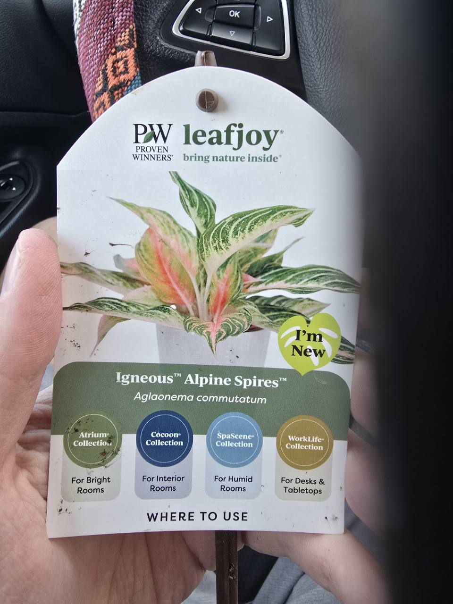
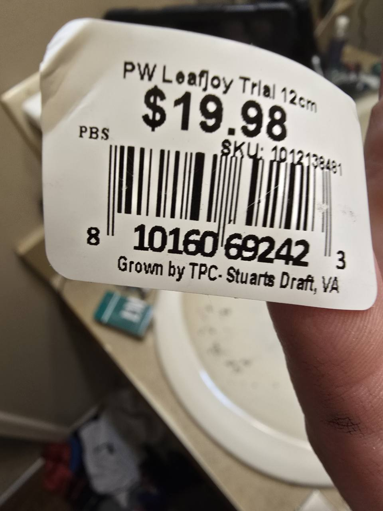

# Alpine Spires Chinese evergreen

- Inventory: Houseplant-08 — _Aglaonema commutatum_, sold as Igneous™ Alpine Spires™
- Label ID: `#15`
- Tracker ID: `P41`
- Visual description: The nursery tag depicts pointed green-and-cream leaves with pink central areas and pink petioles; the owned plant itself has not yet been photographed.
- Interesting fact: Chinese evergreens belong to the arum family: their flowers form a spadix with a surrounding spathe, rather than a conventional petalled bloom.
- Identification: **Nursery-labelled _Aglaonema commutatum_, Igneous™ Alpine Spires™. The photograph documents the tag, not the specimen; exact cultivar denomination and parentage remain unverified.**
- Acquired from: Home Depot; owner report, store location unrecorded; Proven Winners leafjoy nursery branding
- Acquired on: 2026-10-28
- Purchase price: $19.99 paid, owner report October 28; the barcode sticker supplied October 29 shows $19.98. Receipt and tax breakdown not supplied
- Current pot: Unrecorded; repot planned. Retail sticker says 12cm, not a measured pot dimension. Actual dimensions, drainage, growing medium, and final placement remain pending

## Names and identity

| Kind                        | Name                                                           |
| --------------------------- | -------------------------------------------------------------- |
| Nursery-labelled species    | _Aglaonema commutatum_                                         |
| Accepted species name       | _Aglaonema commutatum_ Schott                                  |
| Exact photographed branding | Igneous™ Alpine Spires™; Proven Winners leafjoy                |
| Common names                | Chinese evergreen; Philippine evergreen                        |
| Family                      | Araceae, the arum family                                       |
| Cultivar denomination       | Unverified; no cultivar code or plant-patent number is visible |

The photographed label supplies both the species and trade branding. Retain
that wording rather than substituting another pink Aglaonema selection. The
printed plant image is a marketing reference, not a photograph of the owned
specimen or independent confirmation of its identity.

Kew accepts _Aglaonema commutatum_ Schott, first published in 1856, with a
native range in the Philippines and Sulawesi. That species history does not
date or establish the parentage of Alpine Spires. Proven Winners' Aglaonema
catalog and general care guide were inspected October 28, 2026; an exact Alpine
Spires product page was not located in that search. On **October 29**, the owner
supplied the [matching leafjoy store listing](https://leafjoystore.com/products/igneous-alpine-spires).
It uses **Igneous® Alpine Spires™** and offers **12cm / Grow Pot Kit**. The
photographed **Igneous™** wording is retained above. Store image alt text
associates **“Siam Pink”**; this image alias does not verify a cultivar
denomination or parentage. The page names the genus, not a species;
_A. commutatum_ remains the nursery-label identification.

## Label and acquisition evidence

The owner supplied this full-frame label photograph on **October 28, 2026**
and reported purchasing the plant that day at **Home Depot for $19.99**. Exact
capture time and store location are unrecorded. The owner said it was the only
one in the store and that the barcode label said **“trial.”** The initial
front photograph shows an **“I'm New”** badge; the barcode side was not supplied
until the following day. These retail observations do not establish a limited
release, rarity, introduction year, or registered cultivar.

The tag shows Atrium Collection / For Bright Rooms, Cocoon Collection / For
Interior Rooms, SpaScene Collection / For Humid Rooms, and WorkLife Collection /
For Desks & Tabletops. These are brand placement categories, not measurements
of this plant's room or separate light and humidity targets.

### October 29 barcode evidence

The owner supplied this barcode photograph on **October 29, 2026**, along with
the front-tag view. The sticker directly documents **“PW Leafjoy Trial 12cm”**,
**$19.98**, UPC **`810160692423`**, and **“Grown by TPC- Stuarts Draft, VA”**.
The SKU line is blurred and is not transcribed. “Trial” is now photographed
retail wording; it does not establish a cultivar registration, launch date, or
rarity. The grower-location text is not the purchase-store or owner's location.

Keep the **$19.98 sticker price** separate from the owner's **$19.99 paid-price
report on October 28**; no receipt or payment correction was supplied. The
retail **12cm** designation is not a measurement of the current pot's diameter,
depth, or usable root volume and establishes no drainage or completed repot.
Capture date and time remain unrecorded.

**Repotting and specimen photographs are pending.** The owner plans to take
plant photographs after repotting. No completed repot, new pot, medium recipe,
watering, pest finding, placement, or starting measurement is established by
this enrollment. P41 keeps its permanent ID when its pot setup changes.

## Care in this collection

Begin with manual moisture and plant-condition checks. The current root ball,
pot depth, drainage, room, and light are still unrecorded, so no lamp position,
water quantity, feeding routine, or dry-weight threshold is assigned.

| Topic                | Practical approach                                                                                                                                                                                                                                             |
| -------------------- | -------------------------------------------------------------------------------------------------------------------------------------------------------------------------------------------------------------------------------------------------------------- |
| Light                | Begin with indirect light and gradual acclimation. Keep it out of an abrupt move into the strongest cactus-table exposure. Record the actual position and leaf-height light before choosing settings.                                                          |
| Water                | Let the upper mix begin to dry, then inspect moisture below the surface before watering. Keep the root zone aerated and drain excess water. Do not wait for a cactus-style whole-pot dry plateau or water by a fixed interval.                                 |
| Pot and medium       | Inspect roots and current drainage before the planned repot. Use a draining container and an aerated houseplant medium; preserve the existing planting depth and avoid an unnecessarily large increase in pot volume. Record the actual pot and mix afterward. |
| Temperature          | Use a warm indoor position away from cold drafts and vents. No minimum-temperature experiment is planned for this new plant.                                                                                                                                   |
| Humidity and airflow | Ordinary room conditions may be workable; observe new growth and leaf edges before adjusting humidity. The SpaScene badge does not establish a need for a sealed enclosure or routine misting. Avoid a direct fan blast.                                       |
| Feeding              | Nursery feeding history is unknown. Check for an existing fertilizer charge and active growth before adding fertilizer; enrollment does not start a feeding calendar.                                                                                          |
| Tracker              | Record real observations under P41 / #15. Initial weights and moisture checks can establish a trend after the weighed assembly is consistent; they do not by themselves prove watering readiness.                                                              |

The watering approach combines UF/IFAS guidance to allow slight drying with
NParks' warning about excessive moisture. It is a starting approach for an
unmeasured pot, not a tested Alpine Spires recipe. The manufacturer's general
Aglaonema guidance supports drainage, indirect light, and retaining planting
depth; its calendar watering suggestions are not adopted here. The matching
store listing recommends low-to-medium light and upper-couple-inches drying,
with brighter indirect light for pink color. Its fixed inspection depth is not
adopted for this unmeasured pot.

## Watch points and safety

Inspect leaf undersides, stems, and the pot for pests before placing this
purchase among established plants. NC State lists mealybugs, scale, spider
mites, and aphids as watch points. Yellowing or wilting alone does not identify
the cause; inspect moisture and roots before adding water. Prolonged wetness
raises root-rot risk, while an abrupt increase in exposure may scorch foliage.

**Keep it away from chewing pets and children.** Aglaonema contains irritating
calcium oxalate crystals; chewing plant tissue can irritate the mouth, and sap
may irritate skin. Use gloves when cutting or handling sap, and wash afterward.
This is an ornamental plant, not an edible one.

## Sources

- Owner report and supplied label photograph, October 28, 2026: same-day Home Depot purchase for $19.99; only one seen in the store; owner-reported barcode “trial” wording; planned repot and later specimen photos. The October 28 front image directly supports the nursery wording and “I'm New” badge; the barcode was supplied separately October 29. Owner photograph copyright Nick, all rights reserved.
- Owner-supplied barcode photograph, October 29, 2026, linked above: “PW Leafjoy Trial 12cm”, $19.98 sticker price, UPC `810160692423`, and “Grown by TPC- Stuarts Draft, VA”. The blurred SKU is not transcribed. Retail size, sticker price, and grower text are distinct from measured setup, the owner-reported payment, and the store location. Capture date unrecorded; copyright Nick, all rights reserved.
- [Kew Plants of the World Online: _Aglaonema commutatum_ Schott](https://powo.science.kew.org/taxon/84050-1): accepted species, 1856 publication, Araceae, and native Philippines/Sulawesi distribution. Species history does not confirm this selection's ancestry.
- [leafjoy store: Igneous® Alpine Spires™](https://leafjoystore.com/products/igneous-alpine-spires), accessed October 29, 2026: matching listing; no height or mature dimensions supplied.
- [Proven Winners: Aglaonema catalog](https://www.provenwinners.com/plant-genus/aglaonema), inspected October 28, 2026: brand context; no exact product page was located in that October 28 search. The owner supplied the separate matching leafjoy store page on October 29, linked above.
- [Proven Winners: Chinese evergreen care guide](https://www.provenwinners.com/learn/houseplants/chinese-evergreen): general Aglaonema guidance on indirect light, pot drainage, modest pot-size increases, planting depth, warmth, and sap precautions. These are not specimen measurements or cultivar-specific tolerances.
- [NParks: _Aglaonema commutatum_](https://www.nparks.gov.sg/florafaunaweb/flora/1/6/1611): family, common names, flowers, bright diffused light, well-drained roots, excessive-water risk, and ingestion hazard.
- [University of Florida IFAS: _Aglaonema_ spp., Chinese evergreen](https://ask.ifas.ufl.edu/publication/FP025.pdf): slight drying between waterings, root-rot and yellowing risk with excess water, sun scorch, cold sensitivity, and calcium oxalate irritation. General genus guidance, not an Alpine Spires trial.
- [NC State Extension: _Aglaonema_](https://plants.ces.ncsu.edu/plants/aglaonema/): indirect light, tolerance of drier indoor air, pest watch points, and moisture-related root problems. Its seasonal watering language is not a fixed schedule for P41.
