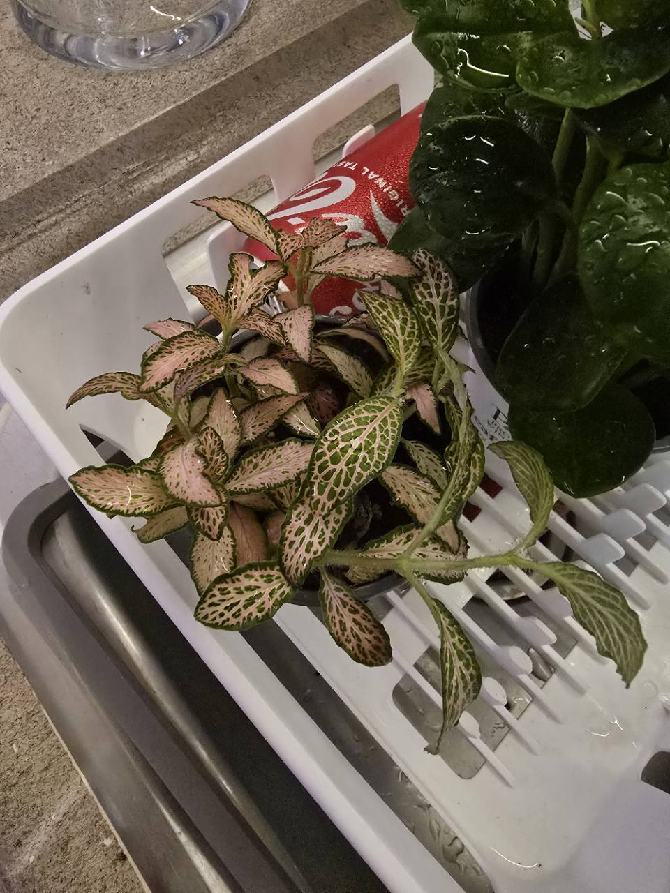
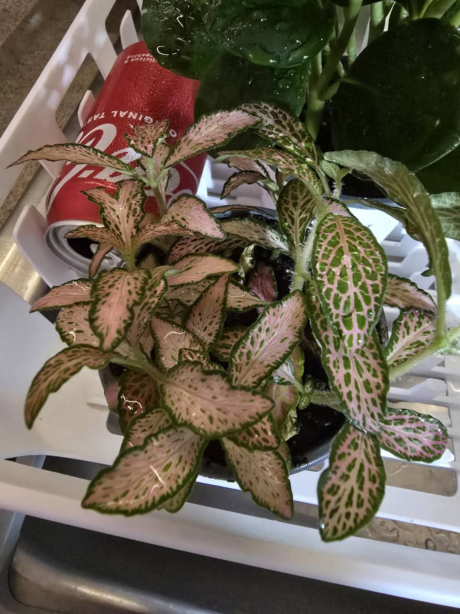

# Nightly nerve plant

- Inventory: Houseplant-06 — _Fittonia albivenis_, sold as Network News™ Nightly™
- Label ID: `#13`
- Tracker ID: `P39`
- Visual description: Small oval leaves have pink netted veins and broad pink areas edged with green; the supplied photographs show hairy trailing stems and some drooping foliage.
- Interesting fact: The species name albivenis means white-veined, although cultivated nerve plants can have pink or red veins too.
- Identification: **Labeled _Fittonia albivenis_, Network News™ Nightly™; leaf and stem appearance is consistent with the label. A separate cultivar denomination is unverified.**
- Acquired from: Retailer unrecorded; Proven Winners leafjoy littles nursery branding
- Acquired on: Exact purchase date unrecorded; owned and photographs supplied 2026-10-21
- Current pot: Nursery container visible in photographs; diameter, depth, drainage, and medium unrecorded

## Names and identity

| Kind             | Name                                             |
| ---------------- | ------------------------------------------------ |
| Accepted species | _Fittonia albivenis_ (Lindl. ex Veitch) Brummitt |
| Nursery branding | Network News™ Nightly™                           |
| Common names     | Nerve plant; mosaic plant                        |
| Family           | Acanthaceae                                      |

The photographed label names the species and Nightly trade branding. Proven
Winners lists the same product with pink-veined foliage. This supports the
nursery identity without establishing a separately registered cultivar name or
genetic identity. **P39 is a separate pot from the probable Fittonia in
[P38's terrarium](./terrarium.md)** and keeps its own history.

Kew accepts the species from southern tropical America, with native records in
Bolivia, northern Brazil, Colombia, Ecuador, Peru, and Venezuela. The accepted
combination dates to 1979; its earlier name _Adelaster albivenis_ dates to 1861.
These are publication dates, not the discovery date of this nursery selection.

## Label and collection evidence

The owner supplied these photographs on **October 21, 2026**; capture time and
purchase date are unrecorded. The label carries the Cocoon and WorkLife
collections. These are product categories, not measured light or humidity
requirements. Drooping leaves and visible water droplets do not establish
root-zone moisture, a completed watering, or the cause of wilting.

## Care in this collection

Placement, leaf-level light, current room conditions, pot dimensions, drainage,
medium, nursery fertilizer charge, and previous watering remain unrecorded.
Enrollment supplies no weight or care event. Use direct checks while these
basics are being established.

| Topic                | Practical approach                                                                                                                                                                                                                                                                                            |
| -------------------- | ------------------------------------------------------------------------------------------------------------------------------------------------------------------------------------------------------------------------------------------------------------------------------------------------------------- |
| Light                | Start with bright indirect light and gradual acclimation. Keep it out of an abrupt move into the strongest cactus exposure; record its actual position before assigning lamp settings.                                                                                                                        |
| Water                | Maintain lightly moist, aerated medium. Check the upper mix and accessible root zone as the surface begins to dry; do not wait for whole-pot drought or a cactus dry-weight plateau. The brand's top-inch check must be scaled to the still-unmeasured pot depth. Drain excess water when watering is needed. |
| Humidity and airflow | Avoid drying drafts and a direct fan blast. The brand prefers high humidity, while extension guidance describes medium humidity; actual room conditions and leaf response should guide any adjustment. No humidity target or closed enclosure has been assigned to this pot.                                  |
| Pot and medium       | Confirm drainage before watering through. Inspect the nursery medium and roots before deciding whether a repot is needed; no pot size, mix recipe, or completed repot is assumed.                                                                                                                             |
| Tracker              | Manual moisture and plant-condition checks. Weights support a trend once the weighed assembly is consistent; they cannot alone determine readiness.                                                                                                                                                           |
| Feeding              | Nursery feeding history is unknown. Check the existing fertilizer charge and active growth before choosing a feeding plan; no automatic feed/plain-water alternation is assigned.                                                                                                                             |

## Watch points

Inspect leaf undersides, nodes, and the pot before placing it among established
plants. If it droops, check the mix first: dry roots and persistently wet roots
need different responses. Do not add water simply because the photographed
leaves hang down. Soft dark stems, persistent decline in wet medium, or new
scorched edges warrant reassessing roots, drainage, or exposure.

## Sources

- Owner-supplied label and plant photographs, October 21, 2026, linked above: nursery wording, visible appearance, and separate pot; purchase/capture dates and growing conditions unrecorded. Owner photographs remain copyright Nick, all rights reserved.
- [Proven Winners: Network News™ Nightly™](https://www.provenwinners.com/plants/fittonia/network-news-nightly-nerve-plant-fittonia-albivenis): product identity, indirect light, moist but draining medium, and brand humidity guidance. These are horticultural starting points, not measurements of P39.
- [Kew Plants of the World Online: _Fittonia albivenis_](https://powo.science.kew.org/taxon/urn:lsid:ipni.org:names:105033-2): accepted name, family, native distribution, 1979 combination, and 1861 basionym.
- [NC State Extension: _Fittonia albivenis_](https://plants.ces.ncsu.edu/plants/fittonia-albivenis/): name meaning, pink/red/white veins, shallow roots, drought wilting, and sensitivity to dry air and direct sun. Its calendar watering suggestion is not adopted for this unmeasured nursery pot.
