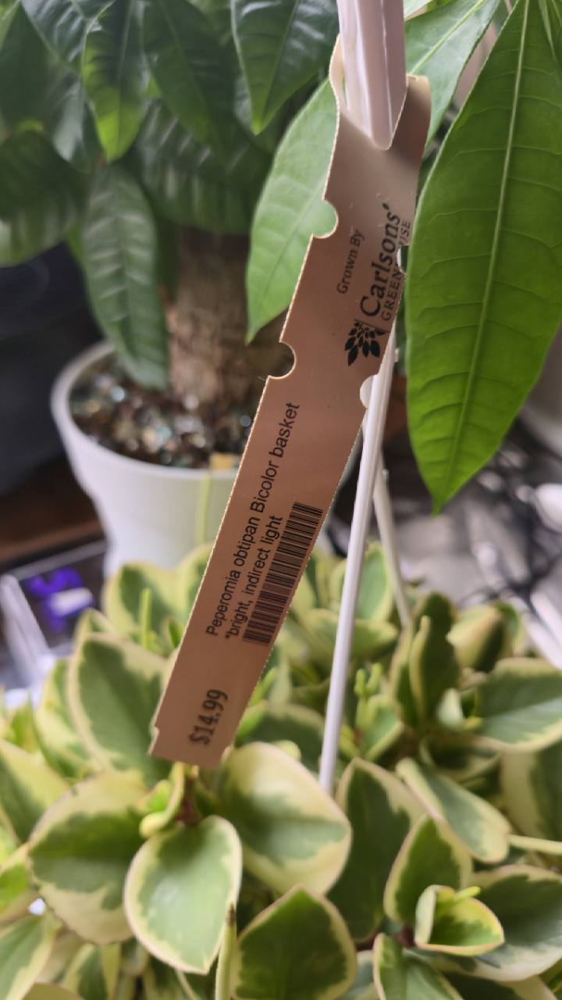

# Peperomia Bicolor

- Inventory: Houseplant-03 — _Peperomia obtusifolia_ 'Obtipan Bicolor'
- Label ID: `#7`
- Tracker ID: `P31`
- Visual description: A compact, branching houseplant with thick, rounded green leaves and broad cream-colored variegation; the photographed purchase is in a hanging nursery basket.
- Interesting fact: A slender cream-colored spike is an entire crowded cluster of minute, petal-less flowers. Each tiny flower has just two stamens, so the plant's flowering display looks more like a thin tail than a bouquet.
- Identification: **seller-labeled “Peperomia obtipan Bicolor”; consistent with the RHS-listed _Peperomia obtusifolia_ 'Obtipan Bicolor', with cultivar identity based on nursery provenance**
- Acquired from: Carlson's Greenhouses
- Acquired on: 2026-09-20
- Current pot: Amazon Basics eight-inch drainage pot; completed repot reported October 24, 2026 as about two weeks earlier; current medium estimated at 30% perlite + 70% greenhouse houseplant mix; internal dimensions unmeasured

## Names and identity

| Kind                   | Name                                      |
| ---------------------- | ----------------------------------------- |
| Working cultivar       | _Peperomia obtusifolia_ 'Obtipan Bicolor' |
| Collection common name | Peperomia Bicolor                         |
| Exact nursery wording  | “Peperomia obtipan Bicolor basket”        |
| Species common names   | Baby rubber plant; blunt-leaved peperomia |

The species is _Peperomia obtusifolia_; “Obtipan” is part of the cultivar name on the tag. RHS lists the full name 'Obtipan Bicolor'.

The USPP29598P3 breeder record describes green-leaved 'Obtipan' as a cross between two unnamed _P. obtusifolia_ cultivars. The separate history of the Bicolor selection is unrecorded.

## Purchase and label evidence

Purchased at Carlson's Greenhouses on **September 20, 2026**, in a nursery basket reported as six inches wide. The tag names Carlson's as grower and reads “Peperomia obtipan Bicolor basket”, “bright, indirect light”, and **$14.99**.

This plant is **P31 / #7 / Houseplant-03**.

## Current kitchen placement and completed repot

**October 24 owner update:** P31 / #7 Peperomia Bicolor and P32 / #8 Tricolor oyster plant are on a **kitchen window shelf**, under the owned **FECiDA 54 W six-tube LED fixture and one Juhefa 10 W three-head fixture**. The owner reports completing the repots and kitchen move about two weeks before October 24; exact dates and times are unrecorded. Their current mix is estimated at **30% perlite + 70% greenhouse houseplant mix**. The previously selected Amazon Basics eight-inch drainage pots are now reported in use; internal dimensions and actual leaf-height exposure remain unmeasured. The earlier floor position and proposed living-room sliding-door arrangement are historical.

The [equipment inventory](../../equipment/inventory.md#lights-and-controls) retains exact models and seller ratings. The kitchen window's orientation, shelf height, timer settings, dimming, lamp-to-leaf distances, temperature, and humidity are unrecorded. Measure the lamps together at representative leaves after dark, then assess daylight separately.

### Historical September living-room plan

The September 22 proposal placed P32 closest to the north-facing living-room sliding glass door and P31 on the smallest Bamworld stool, with FECiDA light and possible Juhefa fill. The October 24 kitchen report supersedes that destination; stool receipt, assembly, and use remain unconfirmed. The [earlier light comparison](../../layouts/table-placement-research.md#planned-living-room-window-and-leds) is retained as dated planning evidence, not an applied kitchen program.

## Origin and form

_Peperomia obtusifolia_ is a tropical American perennial in the pepper family. Its glossy leaves broaden toward their rounded tips, cup slightly, and attach by short stalks to fleshy branching stems. The recessed midrib is a useful detail to look for on a leaf. Despite the thick foliage, the roots tolerate neither persistently wet nor very dry soil.

## Care in this collection

Reported room conditions on September 20, 2026 were approximately **45–50% relative humidity** and temperatures **in the 70s °F**. These are approximate observations, not a daily minimum/maximum record. On September 27, the owner confirmed this plant had just been watered at the September 20 pickup. The exact watering time and any nutrients in that water are unknown; that completed nursery watering does not establish present root-ball moisture.

| Topic                      | Practical approach                                                                                                                                                                                                                                                                                                                        |
| -------------------------- | ----------------------------------------------------------------------------------------------------------------------------------------------------------------------------------------------------------------------------------------------------------------------------------------------------------------------------------------- |
| Light                      | Bright indirect light, consistent with the nursery label and extension guidance. Keep the cream-variegated leaves out of an abrupt move into the strongest cactus exposure.                                                                                                                                                               |
| Proposed starting exposure | **About 4–6 mol·m⁻²·day⁻¹ initially**, with **6–10** a possible settled comparison range if new growth remains compact and undamaged. These are conservative collection-specific trial ranges inferred from bright-indirect guidance, not measured cultivar thresholds or an established optimum.                                         |
| Grow-light position        | Kitchen window shelf beside the other houseplant, under FECiDA 54 W six-tube + one Juhefa 10 W three-head fixture; owner-confirmed October 24. Actual runtime, clearances, leaf-height light, and window orientation are unmeasured.                                                                                                      |
| Water                      | RHS recommends allowing the mix to partially dry between waterings. Check the upper mix and accessible root zone while avoiding prolonged whole-pot drought. A wet root zone, even under a dry surface, is a reason to wait. Check current pot drainage, water through when needed, and empty retained runoff.                            |
| Tracker                    | Treat this as a manual moisture-check houseplant. A pot weight can document a trend, but a cactus plateau or prior dry reference alone cannot decide watering. Use the current pot setup and recent observations when comparing weight trends.                                                                                            |
| Pot and medium             | Completed Amazon Basics eight-inch drainage-pot repot reported about two weeks before October 24. Current medium: approximately 30% perlite + 70% greenhouse houseplant mix, owner estimate. Keep holes clear and empty retained runoff; internal depth and current root condition remain unmeasured.                                     |
| Temperature and airflow    | Keep in a warm indoor position away from cold glass or drafts, with gentle moving air rather than a continuous direct fan blast.                                                                                                                                                                                                          |
| Feeding                    | Next ready watering: **plain RO**. Once settled and growing, use **Foliage-Pro 9-3-6, 1/4 tsp/US gal**, at most every second ready watering. See the [feeding plan](../../equipment/msu-fertilizer-schedule.md#september-27-foliage-pro-starting-plan) for nursery-charge checks, plain-RO fallback and small batches. No extra weighing. |

The earlier living-room DLI comparisons are planning estimates, not measured kitchen exposure or cultivar thresholds. The installed kitchen pair should be measured together at the actual leaves; check brighter and shaded positions and assess daylight separately. Acclimate gradually and judge new growth alongside actual root-zone moisture. The cactus display's timer and readings do not describe this shelf.

## Watch points and propagation

- Check the undersides, leaf axils, stems, and basket before placing the new plant among the established collection.
- Persistently wet mix, soft stems, or declining roots need inspection. A soft leaf alone does not distinguish thirst from root damage.
- Pale or scorched patches after a move warrant reassessing exposure; elongated, weak new growth can warrant a gradual increase after root and moisture checks.
- Establish the purchased plant before taking cuttings. RHS recommends softwood stem cuttings rooted in free-draining medium or in water before potting; NC State also lists leaf cuttings for this species. Check the new plant's leaf pattern as it develops.

## Sources

- Owner clarification, October 24, 2026: kitchen window-shelf placement under the owned 54 W six-head and 10 W three-head LEDs; completed P31/P32 repots and move about two weeks earlier; approximately 30% perlite and 70% greenhouse houseplant mix. Exact dates, times, dimensions, and light settings remain unrecorded.

- Owner clarification, September 27, 2026: watered at the September 20 pickup, with nursery fertilizer use unreported. The requested [Foliage-Pro starting plan](../../equipment/msu-fertilizer-schedule.md#september-27-foliage-pro-starting-plan) distinguishes the historical manufacturer dilution from the collection's gentler frequency; no feed is recorded as completed.

- [Iowa State Extension: supplemental-light considerations](https://yardandgarden.extension.iastate.edu/how-to/growing-indoor-plants-under-supplemental-lights/important-considerations-providing-supplemental-light-indoor-plants) and [University of Minnesota Extension: indoor lighting](https://extension.umn.edu/garden-and-home/yard-and-garden/gardening-in-minnesota/lighting-for-indoor-plants): generic foliage DLI categories, PPFD conversion, and suggested light duration. The collection's Bicolor ranges remain an inference, not published cultivar thresholds.

- Collection observations and plans, September 21–22, 2026: north-facing living-room layout, P31 stool/P32 glass-side positions, and FECiDA purchase. The [equipment record](../../equipment/inventory.md#lights-and-controls) includes the FECiDA, two Juhefas, and optional Diivoo; light ratings are seller specifications, and installation is unconfirmed.

- Collection observations, September 20, 2026: six-inch nursery pots on the room-side floor; two eight-inch Amazon Basics destination pots, one decorated; airy greenhouse mix containing perlite; approximately 45–50% RH and temperatures in the 70s °F. Root condition and nursery feeding history are unrecorded.

- [Owner's September 20, 2026 acquisition photograph with Carlson's Greenhouses grower tag](../../../assets/nursery-labels/2026-09-20-p33-peperomia-obtipan-bicolor-acquisition.jpg) and purchase confirmation: purchase date, exact nursery wording, bright-indirect instruction, displayed $14.99 price, and purchase basket.
- [RHS: _Peperomia obtusifolia_ 'Obtipan Bicolor'](https://www.rhs.org.uk/plants/379773/peperomia-obtusifolia-obtipan-bicolor-v/details): recognized horticultural name and cultivar record.
- [USPP29598P3: Peperomia plant named 'Obtipan'](https://patents.google.com/patent/USPP29598P3/en): breeder account, same-species parents, and distinction from an unsupported interspecific-hybrid claim.
- [NC State Extension: _Peperomia obtusifolia_](https://plants.ces.ncsu.edu/plants/peperomia-obtusifolia/): tropical origin, form, bright indirect light, sensitivity to wet and very dry soil, and propagation.
- [RHS: How to grow peperomia](https://www.rhs.org.uk/plants/peperomia/how-to-grow-peperomia): partial drying between waterings and condition-led watering.
