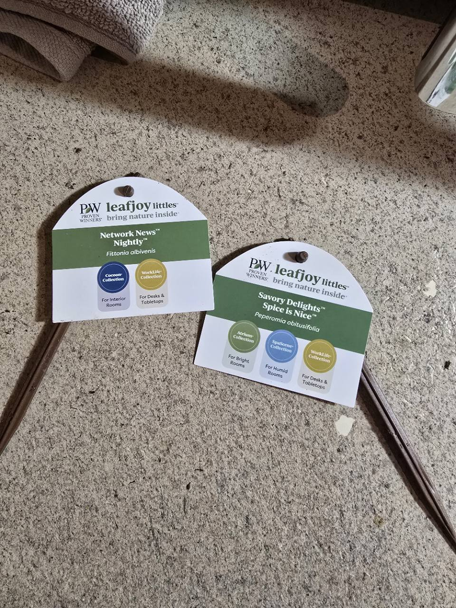
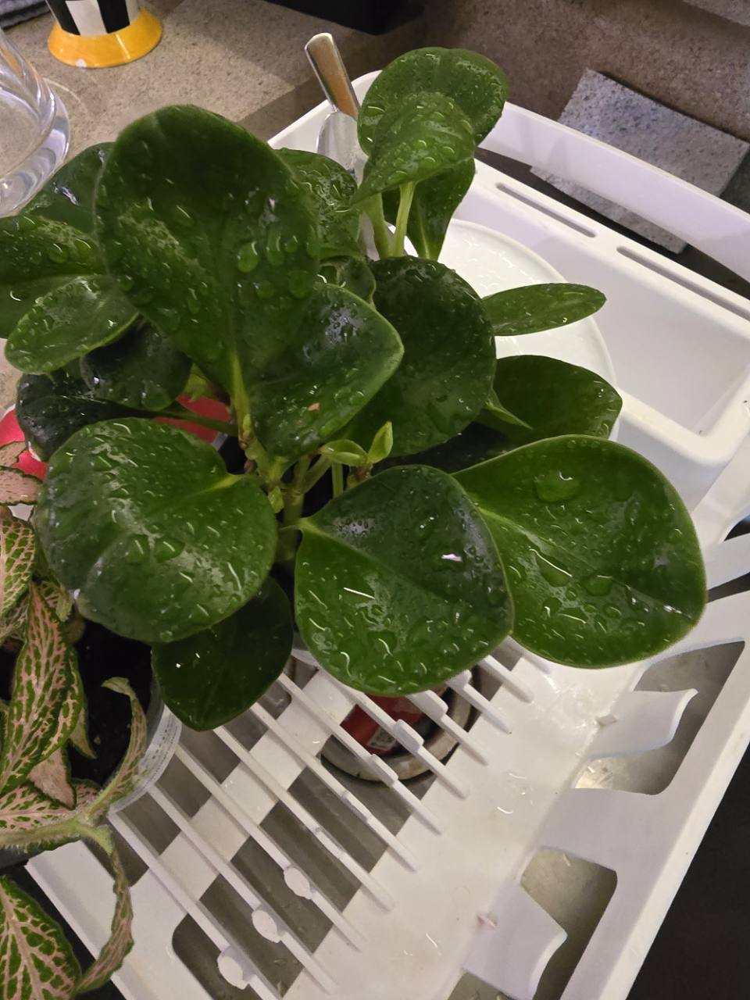

# Spice is Nice peperomia

- Inventory: Houseplant-07 — _Peperomia obtusifolia_, sold as Savory Delights™ Spice is Nice™
- Label ID: `#14`
- Tracker ID: `P40`
- Visual description: Thick, glossy dark-green leaves with rounded ends and slightly cupped blades grow on fleshy upright stems; water droplets are visible in the supplied photographs.
- Interesting fact: Its cream-colored flower spikes carry tiny flowers rather than a showy petalled bloom; the baby rubber plant common name does not make it a rubber tree.
- Identification: **Labeled _Peperomia obtusifolia_, Savory Delights™ Spice is Nice™; photographs are consistent with that species. Proven Winners associates the trade name with more than one cultivar; the exact cultivar of this plant is unverified.**
- Acquired from: Home Depot, Howell, Michigan; owner clarification October 22, 2026; Proven Winners leafjoy littles nursery branding
- Acquired on: 2026-10-21
- Current pot: Nursery container pending repot; diameter, depth, drainage, and medium unrecorded. A glass pot with a drainage hole is a planned replacement, not the current setup

## Names and identity

| Kind                                | Name                                                                                |
| ----------------------------------- | ----------------------------------------------------------------------------------- |
| Nursery-labelled species            | _Peperomia obtusifolia_                                                             |
| Exact photographed branding         | Savory Delights™ Spice is Nice™                                                     |
| Manufacturer's cultivar association | 'EC-PEPE-1806' USPP31,313 and 'EC-PEPE-2103' USPP34,605; exact selection unverified |
| Common names                        | Baby rubber plant; oval leaf peperomia                                              |
| Family                              | Piperaceae, the pepper family                                                       |

The label supplies the species and trade name. The official product page uses
Savory Delights® and names 'EC-PEPE-1806', while the brand's 2025–26 protected
varieties list associates Spice is Nice™ with both 'EC-PEPE-1806' and
'EC-PEPE-2103'. The photographed tag does not distinguish them, so this plant's
exact cultivar remains unverified. The tag's ™ wording is retained as evidence. Do not rename it
'Obtipan Bicolor': the existing [Peperomia Bicolor](./peperomia-obtipan-bicolor.md)
is **P31 / #7**, a separate variegated plant with its own history.

NC State describes _P. obtusifolia_ as a tropical evergreen with glossy,
cupped leaves and branching stems. The thick foliage does not justify using
the cactus watering routine. Kew accepts _Peperomia obtusifolia_ (L.) A.Dietr.,
native from Florida through tropical America. Its accepted combination was
published in 1831, following _Piper obtusifolium_ in 1753. Those dates describe
the species name, not the introduction of the nursery selection.

## Label and collection evidence

The owner supplied the photographs on **October 21, 2026** and later confirmed
purchasing the plant that day at Home Depot in Howell. Capture time remains
unrecorded. The tag's Atrium, SpaScene, and WorkLife categories
describe marketing placements. They do not establish this plant's actual
position or a need to keep it in a humid enclosure. Visible droplets do not
establish when or whether the root ball was watered.

## Care in this collection

**Owner clarification, October 22:** P40 and P39 are quarantined in another
room for roughly a week or until the planned repots. Exact placement,
leaf-level light, and room conditions are unmeasured. Both received **RO water
on the evening of October 21**, their purchase day, because the owner described the medium as
extremely dry. Exact time, water volume, fertilizer use, and weights were not
supplied. This is owner-reported care; it does not verify a saved live tracker
entry or establish their present moisture.

Irregularly shaped glass replacement pots with drainage holes are available,
with acrylic painting below the soil line planned **on the outside only**.
The owner plans measurements tonight; dimensions, paint product, and completed
curing remain unconfirmed. Additional VERYPLANTS aroid/orchid mixes
are expected in a few days; exact received bags and each plant's final recipe
are pending. See the [planned setup](../../setup.md).
The repot has not been reported complete; the nursery medium and fertilizer
charge remain unknown.

**Mix-selection assessment:** Molly's Aroid Mix is a plausible trial medium
given the manufacturer's fast-draining structure and NC State's warning about
persistent wetness in _P. obtusifolia_. This is a suitability inference, not a
tested recipe for P40. Check the actual bag texture and root-ball fit before
choosing the pot or adding the coarser orchid mix; no fixed blend is assigned.

| Topic                | Practical approach                                                                                                                                                                                                                                                                                                       |
| -------------------- | ------------------------------------------------------------------------------------------------------------------------------------------------------------------------------------------------------------------------------------------------------------------------------------------------------------------------ |
| Light                | Bright indirect light, introduced gradually. Confirm the intended position before choosing a grow-light setting; this is not automatically assigned to the cactus tables or P31's planned living-room setup.                                                                                                             |
| Water                | Let the medium partially dry, then check below the surface before watering. The brand suggests checking the top 1–2 inches, but scale that depth to the actual nursery pot. Avoid both a persistently wet root ball and prolonged whole-pot drought. Water through only with working drainage and empty retained runoff. |
| Humidity and airflow | Ordinary room conditions may be suitable; record them rather than importing the terrarium's readings. The tag's humid-room category does not require high humidity: the official product page lists low humidity preference, and extension guidance gives medium to low humidity. Avoid cold drafts.                     |
| Pot and medium       | Check drainage, existing mix, and roots before choosing a repot or new pot. No replacement size or mix ratio has been assigned.                                                                                                                                                                                          |
| Tracker              | Manual moisture checks; weight trends are supporting evidence and no cactus plateau establishes readiness. Keep P40 separate from P31's history.                                                                                                                                                                         |
| Feeding              | Check nursery feeding history and new growth before adding fertilizer. No completed feed or automatic feed/plain-water alternation is recorded.                                                                                                                                                                          |

## Watch points

Check undersides and leaf axils for pests before placement. NC State names
mealybugs, spider mites, and whiteflies as pests to monitor. Yellowing leaves
with persistently wet medium warrant a drainage/root check; soft foliage alone
does not identify thirst. Reassess exposure if new pale or scorched patches
appear after a move. Establish the purchased plant before taking cuttings.

## Sources

- Owner clarification, October 22, 2026: Home Depot in Howell purchase and RO watering on the evening of October 21 after very dry medium; separate-room quarantine; irregular glass drainage pots with exterior-only acrylic painting planned; measurements expected that evening; incoming VERYPLANTS mixes. Exact watering time/volume, paint product, pot dimensions, and completed repot remain unrecorded.
- [VERYPLANTS: Molly's Aroid Mix](https://veryplants.com/products/mollys-aroid-mix-premium-tropical-plant-soil-mix) and [Molly's Orchid Mix](https://veryplants.com/products/mollys-orchid-mix), inspected October 22, 2026: manufacturer descriptions of the two candidate media. Product descriptions are not evidence of the owner's exact received bags or plant-specific performance.

- Owner-supplied label and plant photographs, October 21, 2026, linked above: exact label wording, separate container, and visible form; capture time unrecorded. Owner photographs remain copyright Nick, all rights reserved.
- [Proven Winners: Savory Delights® Spice is Nice™](https://www.provenwinners.com/plants/peperomia/savory-delights-spice-nice-baby-rubber-plant-peperomia-obtusifolia): trade-name/cultivar association, glossy foliage, indirect light, drainage, and humidity guidance. Its depth-based watering advice must be scaled to the actual pot.
- [NC State Extension: _Peperomia obtusifolia_](https://plants.ces.ncsu.edu/plants/peperomia-obtusifolia/): family, foliage and flower form, bright indirect light, wet/very-dry soil sensitivity, humidity guidance, and pests.
- [RHS: How to grow peperomia](https://www.rhs.org.uk/plants/peperomia/how-to-grow-peperomia): partial drying, root inspection before repotting, and avoiding overwatering.

- [Proven Winners 2025–26 protected plant varieties, page 19](https://www.provenwinners.com/sites/provenwinners.com/files/pdf/2025-26_proven_winners_protected_plant_varieties.pdf): two cultivar denominations associated with Spice is Nice; the trade label alone cannot distinguish them.
- [Kew Plants of the World Online: _Peperomia obtusifolia_](https://powo.science.kew.org/taxon/urn:lsid:ipni.org:names:679269-1): accepted species, Florida-to-tropical-America range, 1831 combination, and 1753 basionym.
