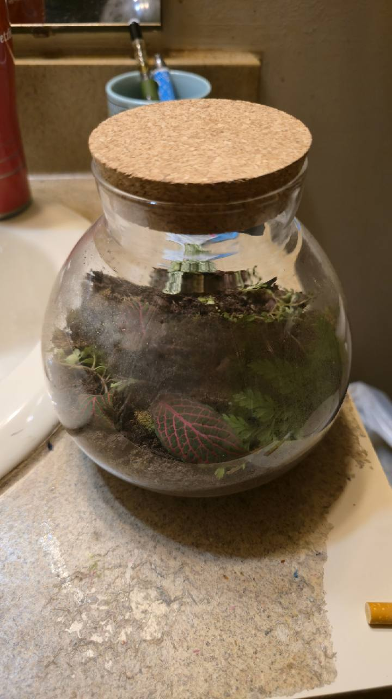
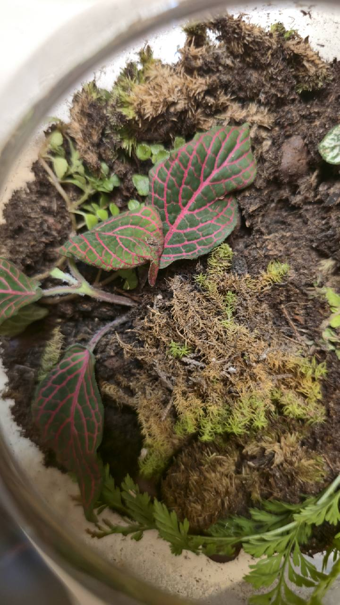
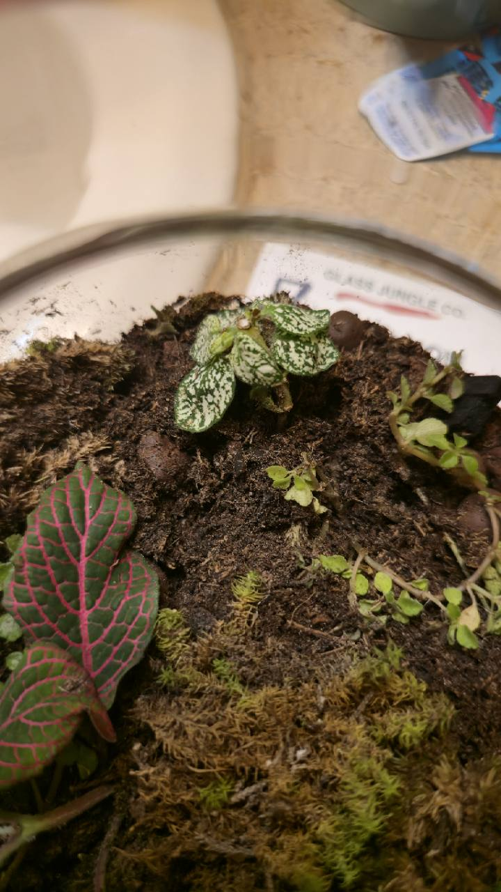
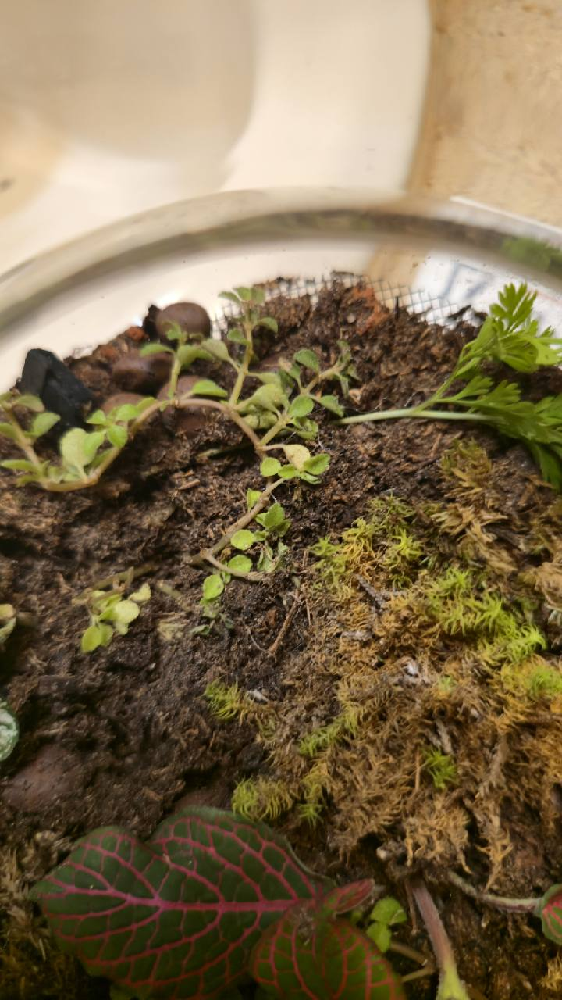
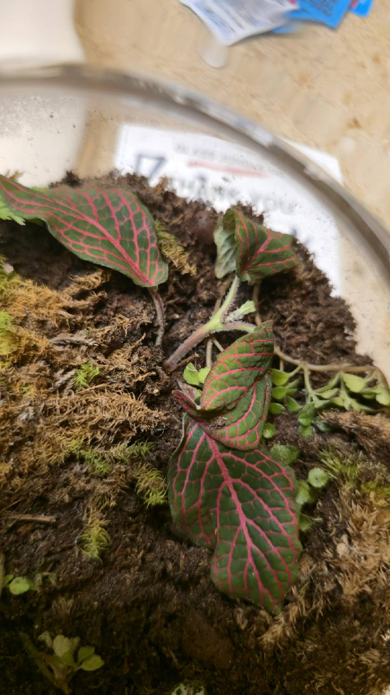

# Terrarium

- Inventory: Houseplant-05 — mixed terrarium; provisional plant identifications
- Label ID: `#12`
- Tracker ID: `P38`
- Status: Active aggregate profile; one mixed houseplant container with provisional botanical identities
- Visual description: Rounded glass jar with a cork lid, red-veined green leaves, white-speckled foliage, small trailing stems, divided fern-like foliage, and brown-and-green moss; the arrival photographs show flattened and displaced growth after shipping.
- Interesting fact: A closed terrarium recirculates moisture, so condensation and high air humidity do not by themselves establish whether its root zone needs water.
- Identification: **Probable Fittonia albivenis and Hypoestes phyllostachya; tentative Pilea cf. depressa; fern-like foliage and moss unidentified. Cultivars unknown. These are photo-based comparisons, not seller-confirmed species.**
- Acquired from: Seller identity unrecorded; made-to-order terrarium listing supplied by owner
- Acquired on: Exact delivery date unconfirmed; enrolled 2026-10-09; arrival-condition photographs supplied 2026-10-10
- Current pot: Cork-lidded glass jar; seller-listed 6.3 × 3.9 in (16 × 10 cm), dimension orientation unverified; owner-reported LECA/larger volcanic-rock lower layers and fluffy coir-containing upper medium; exact recipe, internal depth, and drainage outlet unconfirmed

## Names and identity

| Visible group                          | Working identification                     | Confidence                                  |
| -------------------------------------- | ------------------------------------------ | ------------------------------------------- |
| Red-veined green foliage               | _Fittonia albivenis_, nerve plant          | Probable; cultivar unknown                  |
| White-speckled green foliage           | _Hypoestes phyllostachya_, polka-dot plant | Probable; cultivar unknown                  |
| Small rounded leaves on trailing stems | _Pilea_ cf. _depressa_                     | Tentative comparison; low confidence        |
| Divided green foliage                  | Unidentified fern-like planting            | Insufficient diagnostic views               |
| Brown and green surface mat            | Unidentified moss                          | Species and brown-area viability unresolved |

The netted veins and hairy stems support the Fittonia comparison; the irregular
white spotting supports Hypoestes. The small trailing leaves resemble the RHS
description of _Pilea depressa_, but close views of leaves and nodes are needed.
No named fern or moss species can be supported from the supplied views.

The seller describes variable live moss, small terrarium plants, natural
hardscape, and substrate, with no species list. The whole jar is **Houseplant-05
/ P38 / #12** under Houseplants. This is an aggregate overview, not one verified
species or five botanical member records. Keep one care and weight history.

## Arrival and enclosure evidence

Five owner photographs supplied October 10, 2026 document the jar after
shipping. The owner reports damage; the seller expects recovery, but no recovery
time or root-health conclusion is verified. The complete
[arrival record](../../terrarium.md#arrival-photographs) preserves all five views,
the shipping report, and identification details. Owner photographs remain
copyright Nick, all rights reserved, separate from licensed reference images.

The visible diagnostic clues are above the substrate: leaf veins, spotting,
shape, and stem habit. None of these views exposes roots or establishes which
stems share a root system; surface moss condition does not reveal the moisture
or health of the underlying root zone.

The seller lists **6.3 × 3.9 in (16 × 10 cm)**. The dimension orientation is
unverified; these are seller figures, not measured height, diameter, substrate
depth, or root volume. Dark medium, moss, round brown pieces, and a mesh edge are
visible; a drainage outlet or water reservoir is not established. The owner believes the seller dimensions may be internal, clarified October 24; that is unverified.

The owner reported a shelf near, but not close to, the cactus grow area on October 10, with about
**9,000 lux outside the glass on the light-facing side**. Photographs supplied October 22 show the jar on the desk to the right of the table display; capture date is unrecorded. The October 24 report gives about **6,000–7,000 lux** currently, with meter position and settings unknown. The earlier proposed 7,000-lux adjustment was not a plant threshold.
Leaf-level light, lamp identity, distance, and duration are unrecorded.

A mini sensor hanging below the cap reportedly read **99% RH with fogged glass**
on October 10. Model, reading time, and temperature are unknown. The seller's
**90% RH** suggestion is retained as seller advice, not a verified care target.

**October 24 owner update:** the original lower layers are **LECA balls and larger volcanic rock**, beneath a **fluffy, light, coco-coir-containing upper substrate**. The seller's exact upper-layer recipe is unknown. Current light is reported as **about 6,000–7,000 lux**; meter position, leaf-height exposure inside the jar, light duration, and lamp settings are unrecorded. The owner leaves the lid off for a couple of hours when heavy fog persists all day. No direct watering has been reported; the jar was **misted once on October 23**, after a moisture meter indicated dry. Exact time and volume are unknown; this report does not verify a saved Mist event.

## Practical care for this jar

| Area                 | Starting practice                                                                                                                                                                                                                                                                                             |
| -------------------- | ------------------------------------------------------------------------------------------------------------------------------------------------------------------------------------------------------------------------------------------------------------------------------------------------------------- |
| Light                | Bright indirect light. Use the Light & moisture card's cautious foliage trial as a starting comparison, then check each member's response. Measure at representative leaves inside the glass; an outside-glass reading cannot establish the exposure reaching every plant. Keep the jar out of direct sun.    |
| Water                | Inspect the medium and any standing water first. Do not add water solely for shipping wilt, brown moss, or an RH reading; avoid a fixed watering schedule or cactus dry-down rule.                                                                                                                            |
| Lid and condensation | Seller care says keep the lid closed. If condensation stays heavy or dripping, briefly vent or wipe the glass and reassess, following RHS guidance. Owner routine, reported October 24: lid off for a couple of hours when heavy fog persists all day; adjust to observations rather than a fixed daily task. |
| Temperature          | Use a stable room position away from cold drafts, hot windows, and radiators. Check temperature inside the enclosure if it warms under a lamp; room temperature alone does not describe heat trapped in the jar. No common temperature limit is established for its unidentified fern-like growth and moss.   |
| Feeding              | Skip routine feeding while the planting is growing normally. Extra fertilizer can accelerate crowding. If growth weakens or leaves yellow, first check light, moisture, and roots; those signs alone do not prove a nutrient shortage. The existing substrate's fertilizer charge is unknown.                 |
| Crowding             | Trim encroaching stems conservatively when they shade another member or press against the glass, and remove the cut material. Do not use fertilizer to force faster recovery or enlarge this small planting.                                                                                                  |
| Recovery             | Remove clearly dead loose debris carefully, preserve living stems, and compare new photographs for posture and new growth. Recovery time is unknown.                                                                                                                                                          |
| Records              | Record humidity in % RH for P38, with time and sensor position. Weigh the same complete assembly consistently; components do not get separate weigh-ins.                                                                                                                                                      |

The card's numeric light band is a **collection trial inferred from a broad
foliage category**, not a tested requirement for this mixed jar. RHS supports
terrarium culture for the probable plant groups, but the fern-like foliage and
moss remain unidentified. Watch the probable Hypoestes for fading markings and
stretching before concluding that its exposure is adequate; also check the
other members for scorch, drying, and heat. The card's approximate white-LED lux
comparison is not a calibration of the nearby grow lights. See the
[light-measurement reference](../../light-moisture.md).

The seller also says to mist only when needed. No water volume, fertilizer dose,
daily venting task, or fixed humidity target has been established for this jar.
Confirm moisture before any addition; persistent fogging alone is not proof of
water pooling below the substrate.

## Watch points

- Inspect flattened foliage for changes rather than diagnosing rot or pests from
  its arrival posture alone.
- Keep new decay, lasting heavy condensation, warming, and actual standing water
  distinct observations; each calls for checking the enclosure.
- Inspect leaf undersides and stem junctions for mealybugs, fine webbing, or
  new leaf spots. Confirm the problem before choosing a treatment; the probable
  Fittonia and Hypoestes are not immune to pests or moisture-related disease.
- Obtain clearer leaves and nodes for the trailing plant, a whole frond and its
  underside for the fern-like growth, and close moss shoots before refining IDs.
- Record actual setup changes when they occur. Recording the seller's jar size
  does not mean the planting was repotted.

## Sources

- Owner clarification, October 24, 2026: original LECA/larger volcanic-rock lower layers, fluffy light coir-containing upper medium, about 6,000–7,000 lux, conditional few-hour lid opening, no direct watering, and one misting on October 23 after a dry meter indication. Seller dimensions may be internal in the owner's view, but no measurement verifies that.

- [Owner arrival record and photographs](../../terrarium.md), supplied October 10,
  2026: shipping condition, provisional identifications, reported placement,
  external-glass lux, and under-cap RH. Capture and delivery times are unconfirmed.
- Seller listing text supplied by the owner October 10, 2026: 6.3 × 3.9 in
  (16 × 10 cm), cork lid, variable planting and hardscape, and care advice.
  Seller identity and listing URL were not supplied; no independent product
  verification or species confirmation is claimed.
- [NC State Extension: _Fittonia albivenis_](https://plants.ces.ncsu.edu/plants/fittonia-albivenis/) — foliage and stem comparison, indirect-light culture, and pest/root-rot watch points; the identification remains probable.
- [NC State Extension: _Hypoestes phyllostachya_](https://plants.ces.ncsu.edu/plants/hypoestes-phyllostachya/) — spotted-foliage comparison, bright filtered light, fading/stretching in inadequate light, and pest/disease watch points.
- [RHS: How to grow pilea](https://www.rhs.org.uk/plants/pilea/how-to-grow-pilea) — tentative _Pilea depressa_ appearance comparison, indirect light, protection from cold drafts, and trimming trailing growth.
- [RHS: Terrariums and bottle gardens](https://www.rhs.org.uk/plants/types/houseplants/bottle-gardens-and-terrariums) — compatible tropical plant groups, indirect light, heat avoidance, condensation management, and debris removal.
- [Iowa State Extension: How to create and care for a terrarium](https://yardandgarden.extension.iastate.edu/how-to/how-create-and-care-terrarium) — shared growing-condition needs, heat risk, sparing water, and avoiding routine fertilizer to limit crowding. Its calendar watering examples are not adopted for P38.
- [Iowa State Extension: supplemental-light considerations](https://yardandgarden.extension.iastate.edu/how-to/growing-indoor-plants-under-supplemental-lights/important-considerations-providing-supplemental-light-indoor-plants) — broad foliage DLI categories and leaf-level measurement. Applying the low-light category to this uncertain mixture is a cautious collection inference, not a species-specific prescription.
