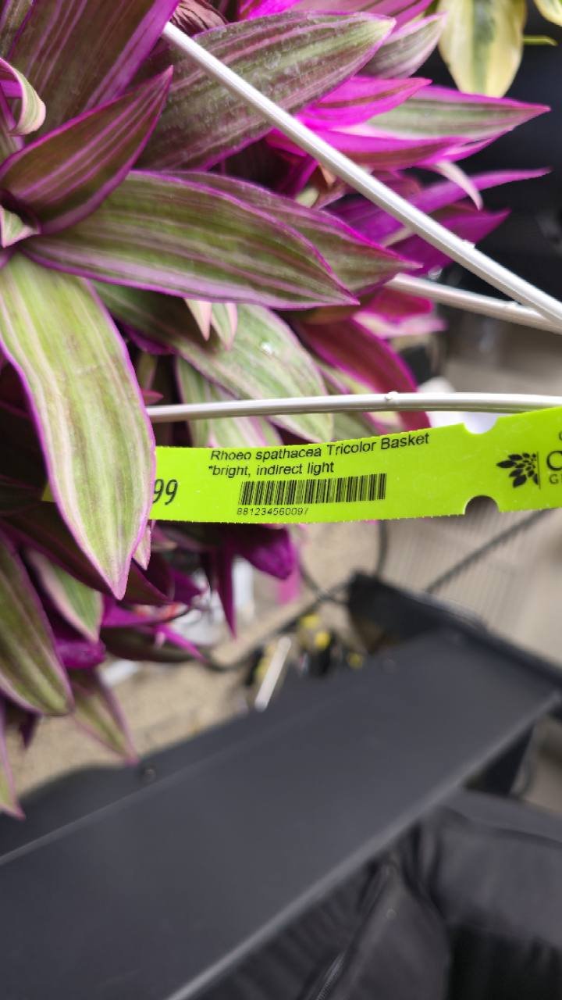

# Tricolor oyster plant

- Inventory: Houseplant-04 — _Tradescantia spathacea_ 'Tricolor'
- Label ID: `#8`
- Tracker ID: `P32`
- Visual description: Compact rosettes of upright, pointed, strap-shaped leaves striped green and cream with pink tones and purple undersides; the photographed purchase is in a hanging nursery basket.
- Interesting fact: The purple boat around the tiny white flowers is made of bracts, or modified leaves, rather than petals. That enclosing shape gives oyster plant its common name; the plant's flowers can be easy to overlook beneath the foliage.
- Identification: **seller-labeled “Rhoeo spathacea Tricolor”; consistent with variegated _Tradescantia spathacea_, with cultivar identity based on nursery provenance**
- Acquired from: Carlson's Greenhouses
- Acquired on: 2026-09-20
- Current pot: Amazon Basics eight-inch drainage pot; completed repot reported October 24, 2026 as about two weeks earlier; current medium estimated at 30% perlite + 70% greenhouse houseplant mix; internal dimensions unmeasured

## Names and identity

| Kind                        | Name                                |
| --------------------------- | ----------------------------------- |
| Accepted species            | _Tradescantia spathacea_ Sw.        |
| Collection cultivar wording | _Tradescantia spathacea_ 'Tricolor' |
| Exact nursery wording       | “Rhoeo spathacea Tricolor Basket”   |
| Collection common name      | Tricolor oyster plant               |
| Other species common names  | Boat lily; Moses-in-the-cradle      |

_Rhoeo spathacea_ is the older botanical name still printed on the nursery tag. Kew accepts _Tradescantia spathacea_. Tradescantia Hub's cultivar register lists 'Tricolor' as a synonym of 'Sitara', a useful cross-reference when comparing plant labels.

This rosette-forming houseplant is **P32 / #8 / Houseplant-04**.

## Purchase and label evidence

Purchased at Carlson's Greenhouses on **September 20, 2026**, in a nursery basket reported as six inches wide. The tag names Carlson's as grower and reads “Rhoeo spathacea Tricolor Basket” and “bright, indirect light”. The purchase price is unrecorded.

## Current kitchen placement and completed repot

**October 24 owner update:** P31 / #7 Peperomia Bicolor and P32 / #8 Tricolor oyster plant are on a **kitchen window shelf**, under the owned **FECiDA 54 W six-tube LED fixture and one Juhefa 10 W three-head fixture**. The owner reports completing the repots and kitchen move about two weeks before October 24; exact dates and times are unrecorded. Their current mix is estimated at **30% perlite + 70% greenhouse houseplant mix**. The previously selected Amazon Basics eight-inch drainage pots are now reported in use; internal dimensions and actual leaf-height exposure remain unmeasured. The earlier floor position and proposed living-room sliding-door arrangement are historical.

The [equipment inventory](../../equipment/inventory.md#lights-and-controls) retains exact models and seller ratings. The kitchen window's orientation, shelf height, timer settings, dimming, lamp-to-leaf distances, temperature, and humidity are unrecorded. Measure the lamps together at representative leaves after dark, then assess daylight separately.

### Historical September living-room plan

The September 22 proposal placed P32 closest to the north-facing living-room sliding glass door and P31 on the smallest Bamworld stool, with FECiDA light and possible Juhefa fill. The October 24 kitchen report supersedes that destination; stool receipt, assembly, and use remain unconfirmed. The [earlier light comparison](../../layouts/table-placement-research.md#planned-living-room-window-and-leds) is retained as dated planning evidence, not an applied kitchen program.

## Origin, publication, and form

Kew records the species as first published in **1788** and native from southern Mexico to Guatemala. The stiff leaves spiral around a short stem, with their broad bases wrapping around it. This close arrangement produces the upright rosette. New rosettes broaden the clump, while small white flowers sit low among the leaves inside boat-shaped bracts.

## Care in this collection

Reported room conditions on September 20, 2026 were approximately **45–50% relative humidity** and temperatures **in the 70s °F**. These are approximate observations, not a daily minimum/maximum record. On September 27, the owner confirmed this plant had just been watered at the September 20 pickup. The exact watering time and any nutrients in that water are unknown; that completed nursery watering does not establish present root-ball moisture.

| Topic                      | Practical approach                                                                                                                                                                                                                                                                                                                        |
| -------------------------- | ----------------------------------------------------------------------------------------------------------------------------------------------------------------------------------------------------------------------------------------------------------------------------------------------------------------------------------------- |
| Light                      | Bright indirect light, as printed on the nursery tag and described by NC State. Increase exposure gradually after purchase; foliage color does not establish tolerance of the strongest cactus position.                                                                                                                                  |
| Proposed starting exposure | **About 6–8 mol·m⁻²·day⁻¹ initially**, with **8–12** a possible settled comparison range if new growth remains compact and undamaged. These are conservative collection-specific trial ranges inferred from bright-indirect guidance, not measured cultivar thresholds or an established optimum.                                         |
| Grow-light position        | Kitchen window shelf beside P31, under FECiDA 54 W six-tube + one Juhefa 10 W three-head fixture; owner-confirmed October 24. Actual runtime, clearances, leaf-height light, and window orientation are unmeasured.                                                                                                                       |
| Water                      | NC State advises letting the upper **1–2 inches** dry between waterings in a well-drained medium. Scale the physical check to the actual basket/root ball once measured; do not wait for prolonged cactus-style whole-pot drought. Inspect moisture below a dry surface before watering.                                                  |
| Tracker                    | Use a manual upper-mix and plant-condition check. Weight trends are supporting observations; neither a plateau nor a model date proves readiness. Use the current pot setup and recent observations when comparing weight trends.                                                                                                         |
| Pot and medium             | Completed Amazon Basics eight-inch drainage-pot repot reported about two weeks before October 24. Current medium: approximately 30% perlite + 70% greenhouse houseplant mix, owner estimate. Keep holes clear and empty retained runoff; internal depth and current root condition remain unmeasured.                                     |
| Temperature and airflow    | Keep warm, away from cold glass and drafts, with gentle airflow that does not constantly bend or dry the leaves.                                                                                                                                                                                                                          |
| Feeding                    | Next ready watering: **plain RO**. Once settled and growing, use **Foliage-Pro 9-3-6, 1/4 tsp/US gal**, at most every second ready watering. See the [feeding plan](../../equipment/msu-fertilizer-schedule.md#september-27-foliage-pro-starting-plan) for nursery-charge checks, plain-RO fallback and small batches. No extra weighing. |
| Handling                   | Sap may irritate skin, and the plant is unsuitable for chewing by pets or people. Wear gloves when cutting or dividing, and keep cuttings and sap out of reach.                                                                                                                                                                           |

The earlier living-room DLI comparisons are planning estimates, not measured kitchen exposure or cultivar thresholds. Measure the installed kitchen pair together at the actual leaves and assess daylight separately. Acclimate gradually and judge compact growth and color alongside actual root-zone moisture. The cactus display's timer and readings do not describe this shelf.

**Owner proposal for October 25:** repot P32 again into **75% Molly's Aroid Mix + 25% Molly's Orchid Mix**, cut the shoots back heavily, and remove about **80% of the roots** because it is described as rootbound. This is an uncompleted owner proposal, **not a care recommendation**. Do not remove 80% of healthy roots as a routine repot step. Inspect first, preserve healthy roots, and loosen or selectively trim circling roots; consider division where appropriate. [RHS repotting guidance](https://www.rhs.org.uk/container-gardening/how-to-repot-a-plant) favors limited root reduction, and [Illinois Extension](https://extension.illinois.edu/houseplants/repotting) advises addressing circling roots and preserving the original planting depth. Neither source establishes a species-specific percentage for this plant.

The owner has ordered **8 oz of seller-described “tropical pink” springtails** for planned addition to these pots after arrival. Species, arrival, and actual introduction are unconfirmed; the order does not establish a care benefit or replace drainage and moisture checks.

## Watch points and propagation

- Inspect leaf bases, undersides, and the basket for pests before integrating it with the established collection.
- Soft bases or persistently wet medium call for root-zone inspection. Dry tips or drooping leaves alone do not distinguish excess light, inconsistent moisture, drafts, or root trouble.
- Avoid leaving water pooled around the crowded leaf bases, and preserve airflow without using a harsh fan stream.
- After the plant establishes, division separates an expanded clump into smaller rooted plants. NC State also lists stem cuttings and seed propagation. Wear gloves when handling cut surfaces because the sap irritates skin.

## Sources

- Owner clarification, October 24, 2026: kitchen window-shelf placement, completed P31/P32 repots and move about two weeks earlier, approximately 30% perlite + 70% greenhouse mix; next-day P32 repot and pruning proposed, not completed; tropical pink springtails ordered.
- [RHS: How to repot a plant](https://www.rhs.org.uk/container-gardening/how-to-repot-a-plant) and [Illinois Extension: Repotting](https://extension.illinois.edu/houseplants/repotting), checked October 24: limited root work, circling-root treatment, and original planting depth. General guidance is not a tested species-specific percentage.

- Owner clarification, September 27, 2026: watered at the September 20 pickup, with nursery fertilizer use unreported. The requested [Foliage-Pro starting plan](../../equipment/msu-fertilizer-schedule.md#september-27-foliage-pro-starting-plan) distinguishes the historical manufacturer dilution from the collection's gentler frequency; no feed is recorded as completed.

- [Iowa State Extension: supplemental-light considerations](https://yardandgarden.extension.iastate.edu/how-to/growing-indoor-plants-under-supplemental-lights/important-considerations-providing-supplemental-light-indoor-plants) and [University of Minnesota Extension: indoor lighting](https://extension.umn.edu/garden-and-home/yard-and-garden/gardening-in-minnesota/lighting-for-indoor-plants): generic foliage DLI categories, PPFD conversion, and suggested light duration. The collection's Tricolor ranges remain an inference, not published cultivar thresholds.

- Collection observations and plans, September 21–22, 2026: north-facing living-room layout, P31 stool/P32 glass-side positions, and FECiDA purchase. The [equipment record](../../equipment/inventory.md#lights-and-controls) includes the FECiDA, two Juhefas, and optional Diivoo; light ratings are seller specifications, and installation is unconfirmed.

- Collection observations, September 20, 2026: six-inch nursery pots on the room-side floor; two eight-inch Amazon Basics destination pots, one decorated; airy greenhouse mix containing perlite; approximately 45–50% RH and temperatures in the 70s °F. Root condition and nursery feeding history are unrecorded.

- [Owner's September 20, 2026 acquisition photograph with Carlson's Greenhouses grower tag](../../../assets/nursery-labels/2026-09-20-p34-tradescantia-spathacea-tricolor-acquisition.jpg) and purchase confirmation: exact nursery wording, bright-indirect instruction, purchase date, and purchase basket.
- [Kew Plants of the World Online: _Tradescantia spathacea_](https://powo.science.kew.org/taxon/173471-1): accepted species, native range, and first publication.
- [NC State Extension: _Tradescantia spathacea_](https://plants.ces.ncsu.edu/plants/tradescantia-spathacea/): synonyms, growth form, light, upper-mix drying, drainage, propagation, and handling risks.
- [University of Florida IFAS: _Tradescantia spathacea_](https://ask.ifas.ufl.edu/publication/FP510): clumping growth and white flowers held inside boat-shaped bracts.
- [Tradescantia Hub cultivar register: 'Sitara'](https://tradescantia.uk/cultivar/tra-sitara/): specialist register's 'Tricolor' synonym cross-reference; retained separately from this plant's nursery provenance.
